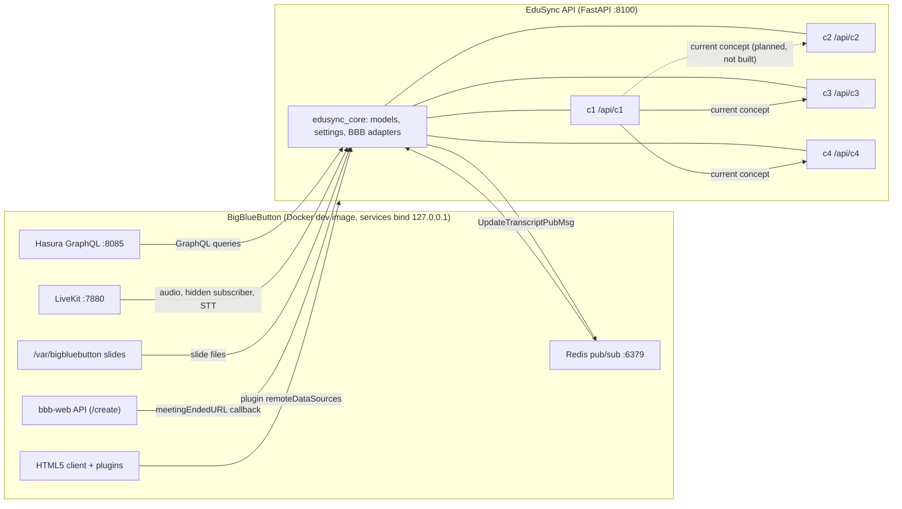

# EduSync AI - Architecture

EduSync AI is an add-on for BigBlueButton (BBB) that helps a lecturer see, during a live lecture, what is being
taught, whether students are following, and whether the discussion is on topic. This repo is a trimmed BBB 4.0.x
fork plus the Python backend in [`edusync/`](../../edusync).

> Items marked **UNVERIFIED** come from reading BBB source code and have not been run against a live BBB server.
> Items marked **BASELINE** are rule-based/heuristic; **FUTURE** needs real ML models.

## 1. The four components

| ID | Name | Job | Main inputs |
|----|------|-----|-------------|
| C1 | Lecturer Monitoring | Track the current concept and curriculum coverage vs. the syllabus; share "current concept" context with the other components | speech transcript, slide text, whiteboard, syllabus |
| C2 | Learning Difficulty Prediction + Comprehension Validation | Before the lecture: predict per-concept difficulty from the lecture file and the C1 graph. Later, live: check it against poll/quiz evidence | lecture file, C1 graph, (later) C1 current concept, polls, quizzes |
| C3 | Pedagogical Relevance | Classify speech/discussion as relevant or unrelated to the current concept | transcript, chat, C1 concept |
| C4 | Live Visual Evidence + Reconciliation | Collect slide and timestamped whiteboard evidence and reconcile it across components (notes optional) | slides, whiteboard annotations, other components' evidence |

All outputs are keyed by **concept + lecture timestamp**; problems are surfaced as **flags for lecturer review**.
Generating notes/summaries is an optional extension, not a core deliverable.

## 2. System diagram

`edusync_core` is the only package meant to talk to BBB. Components use its adapters, so tests can swap in fakes
(see [development.md](development.md)).

## 3. Data flow per component

- **C1**: transcript chunks + slide text (+ whiteboard text) are matched to syllabus concepts, updating the
  "current concept" and a coverage table; skipped/under-covered concepts become `Flag`s. The current concept is
  shared with C2/C3/C4.
- **C2** has two stages. (1) Pre-lecture difficulty pipeline (built as a Phase 1 baseline): lecture file (PPTX/PDF) +
  optional C1 graph JSON -> slide records -> concepts located on slides -> 35 features in four groups (32 implemented, 1 mock, 2 planned) -> model ->
  Low/Medium/High per concept, before the lecture. The model is a rule baseline (not trained) and some inputs and
  features are mocked or TODO; the response labels them. The graph is passed to C2 as a request payload; without it C2
  uses a labelled mock. See [c2-difficulty.md](c2-difficulty.md) and the [C1 -> C2 graph contract](c1-c2-graph-contract.md).
  (2) Live comprehension (later, **FUTURE**): when poll/quiz results for a concept arrive, compare predicted vs.
  observed and flag mismatches. Only a rule-based placeholder exists (`/api/c2/comprehension/evaluate`). The C1 -> C2
  runtime hand-off of the current concept is not implemented. The model interface and logging convention are in [c2-model-and-blueprint.md](c2-model-and-blueprint.md) and [c2-difficulty.md](c2-difficulty.md#logging-and-development-conventions).
- **C3**: score each transcript/chat segment against the current concept; flag sustained off-topic stretches.
- **C4**: collect slide changes and timestamped whiteboard annotations as `EvidenceItem`s; reconcile with
  evidence from C1-C3 (e.g. slide says concept X while speech says Y) and flag conflicts.

## 4. Shared models and contract (`edusync_core`)

- `LectureTimestamp(meeting_id, seconds, wall_clock)`
- `ConceptRef(id, label)`
- `EvidenceItem(concept, source, timestamp, text, confidence, meta)`; source: speech, slide, whiteboard, poll, chat, note
- `Flag(concept, timestamp, component, reason, severity, evidence[])`; severity: info, review, urgent
- `Component(name, title, description, router)` with `prefix = /api/<name>`; each `edusync_cN` package exports
  `COMPONENT`, and the API mounts it.
- `CoreSettings`, env prefix `EDUSYNC_`: data dir, CORS origins, BBB URL/secret, Hasura URL/admin secret, Redis
  URL, Whisper model/device/compute type.
- BBB adapters in core (Hasura GraphQL client, Redis event bus, BBB API client with checksum): planned/in
  progress, check `packages/core/src/edusync_core/` for what exists today.

## 5. API layout

One FastAPI app `edusync_api` (ASGI `edusync_api.asgi:app`, port **8100**):

| Path | Owner |
|------|-------|
| `/health` | API app: status, version, mounted components, whether BBB is configured |
| `/api/components` | API app: lists mounted components and prefixes |
| `/api/c1/...` .. `/api/c4/...` | the matching component package |

Interactive docs: <http://localhost:8100/docs>. Treat `/docs` as the source of truth for component routes.

## 6. BBB integration points (UNVERIFIED, from code analysis)

| Need | Mechanism |
|------|-----------|
| Query state | Hasura GraphQL at `127.0.0.1:8085`, header `x-hasura-admin-secret` (dev default `bigbluebutton` in `bbb-graphql-server/config.yaml`; installed servers: `/etc/default/bbb-graphql-server-admin-pass`) |
| Slide text / URLs | view `pres_page_curr` (`content`, `urlsJson`) |
| Whiteboard | `pres_annotation_history_curr` (`annotationInfo`, `updatedAt`) |
| Polls | `poll`, `poll_response`, `poll_user` |
| Chat | `chat_message_public` |
| Captions/transcripts | `caption`, `caption_history` (AUDIO_TRANSCRIPTION) |
| Meeting/users | `meeting`, `user` |
| Live events | Redis `127.0.0.1:6379`: `from-akka-apps-redis-channel` (meeting lifecycle, polls, chat, `TranscriptUpdatedEvtMsg`), `from-akka-apps-frontend-redis-channel` (whiteboard), `from-akka-apps-pres-redis-channel` (slide changes) |
| Write back | publish to `to-akka-apps-redis-channel` (e.g. `UpdateTranscriptPubMsg`) |
| Live speech | join the LiveKit room (room name = meeting internal id, ws 7880) as a hidden subscriber, run STT (faster-whisper), publish `UpdateTranscriptPubMsg` |
| Lifecycle | `/create` parameters `meetingEndedURL`, `meta_*`, `pluginManifests` |
| Slide files | `/var/bigbluebutton/<meetingId>/<meetingId>/<presId>/{svgs,pngs,thumbnails,textfiles}` |
| BBB API auth | checksum (SHA of call name + query string + shared secret) |

Because BBB services bind to `127.0.0.1`, the Python container uses `docker-compose.sidecar.yml` (shared network
namespace with the BBB container); see [docker.md](docker.md).

## 7. UI / plugin approach

The frontend is BBB's own HTML5 client (`bigbluebutton-html5`). UI changes are made there directly and/or via the
BBB HTML5 plugin SDK (`bigbluebutton-html-plugin-sdk` 1.0.0-beta.3). The SDK's `remoteDataSources` lets a plugin
call our API, so lecturer-facing panels (flags, coverage) can fetch from `/api/c*`. No separate web frontend is
planned. Plugin wiring is not built yet.

## 8. Baseline vs. future ML

- **BASELINE**: keyword/TF-IDF-style matching, heuristics and deterministic fakes; no GPU or model download, fully
  testable in CI.
- **FUTURE**: real STT (faster-whisper, `EDUSYNC_WHISPER_*`), embeddings for concept matching, trained difficulty
  and relevance models. Tests needing real weights use the `ml` marker and are skipped by default.
- Datasets are never committed (`edusync/data/` is for local use). Model files are committed only through Git LFS
  (see `edusync/packages/blueprint_model/artifacts/README.md`).
