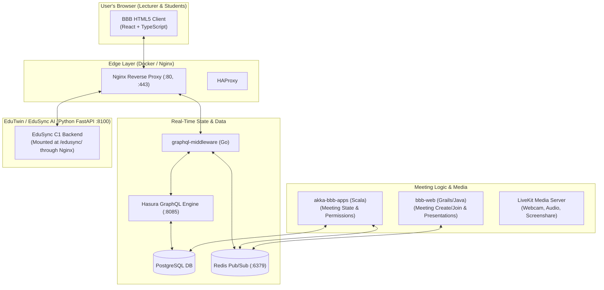

# BigBlueButton (BBB) Frontend Customization & Architecture Guide for EduTwin C1

This document provides a comprehensive research breakdown of how **BigBlueButton (BBB)** works under the hood, how the HTML5 frontend client is customized, how to manually update and reload BBB, and how to wire the **C1 Lecturer Alerts** and **Student Catch-Up Modal** into the user interface.

---

## 1. How BigBlueButton Works Under the Hood

BigBlueButton 4.0 is not a single monolith; it is an orchestrated ecosystem of specialized services:



### Key Takeaways of the Dataflow:
1. **Reads (Subscribing to State):** The React client connects via WebSocket through `graphql-middleware` to **Hasura**, which sends live JSON patches whenever meeting data changes.
2. **Writes (Actions & Mutations):** When a user clicks a button (raise hand, mute, send chat), the React client sends a mutation to `graphql-actions`, which publishes a message to **Redis Pub/Sub**. `akka-bbb-apps` receives it, updates the PostgreSQL database, and Hasura automatically broadcasts the update back to all clients.
3. **EduSync Proxying:** BigBlueButton's nginx has an explicit proxy rule (`docker/bbb/edusync.nginx`):
   Requests to `https://bbb.test/edusync/...` are directly forwarded to EduSync's FastAPI container.

---

## 2. Where the BBB Frontend Code Lives

The frontend is a **React + TypeScript + Webpack** application located in:
`bigbluebutton-html5/`

### Key Directory Structure:
| Path | Purpose | What You Put There |
|---|---|---|
| `bigbluebutton-html5/imports/ui/components/` | All UI components, screens, modals, and toolbars | Your custom modals, notifications, and panels |
| `.../components/sidebar-content/` | Left sidebar tabs (Chat, Notes, User List) | Add a new **"EduTwin Curriculum"** sidebar tab |
| `.../components/banner-bar/` | Top banner notification bar | Lecturer in-session alerts (*"Skipped Base Case"*) |
| `.../components/modal/` | Pop-up modal dialog system | Late-joining student **5-minute catch-up modal** |
| `.../components/actions-bar/` | Bottom control bar (Mic, Camera, Hand) | Custom button to open the Catch-up pack |
| `.../services/` | Client-side data managers | REST client to fetch from `/edusync/api/c1/...` |

---

## 3. How to Update BigBlueButton: Development vs. Production

There are two distinct ways to apply changes to BBB:

### Method A: Live Development with Hot Module Reloading (Recommended)
You can run the frontend in development mode where any change you make to TypeScript/React code instantly updates in your browser without restarting Docker!

1. In PowerShell, run:
   ```powershell
   .\scripts\dev.ps1 html5
   ```
2. What this does inside the container:
   - Switches nginx to use `bbb-html5.nginx.dev`.
   - Starts Webpack Dev Server (`npm start`).
3. Now, whenever you save a `.tsx` or `.jsx` file in `bigbluebutton-html5/`, the browser automatically refreshes with your changes in 2–3 seconds!
4. To stop: press `Ctrl + C`.

---

### Method B: Manual Production Build (When Finalized)
When you are ready to compile your customized frontend permanently:

1. Inside the BBB container (or locally with Node >= 24):
   ```bash
   cd bigbluebutton-html5
   npm ci
   npm run build
   ```
2. Restart the BBB web service:
   ```powershell
   docker compose restart bbb
   ```

---

## 4. How to Wire Your Two C1 Features into the BBB Frontend

### Feature 1: The In-Session Lecturer Skip Alert
Where to display it: In the **Lecturer's Top Banner** or **Toast Notification**:
- **Location:** `bigbluebutton-html5/imports/ui/components/banner-bar/` or `notifications/`.
- **How it works:**
  1. A small polling hook (or WebSocket) in the React client calls:
     ```javascript
     fetch('/edusync/api/c1/lectures/' + meetingId + '/alerts')
     ```
  2. If the user's role is `MODERATOR` (the lecturer) and an active skip alert is returned:
     - Render a dismissible yellow/red alert banner at the top of the screen:
       > ⚠️ **Curriculum Notice:** You jumped to *Slide 12 (BST Balancing)* without introducing *Slide 9 (BST Rotations)*.
  3. Students do **not** see this banner; only the teacher sees it.

---

### Feature 2: The Late-Joining Student 5-Minute Catch-Up Modal
Where to display it: An automatic pop-up dialog for late students:
- **Location:** `bigbluebutton-html5/imports/ui/components/join-handler/` or `modal/`.
- **How it works:**
  1. When a student enters the meeting, the client checks the meeting elapsed time:
     $$\Delta t = \text{currentTime} - \text{meeting.startTime}$$
  2. If $\Delta t > 10\text{ minutes}$ (student is late) and the student hasn't seen the catch-up modal yet:
     - The client calls the EduSync endpoint:
       ```javascript
       fetch(`/edusync/api/c1/lectures/${meetingId}/catchup?join_seconds=${elapsedSeconds}`)
       ```
     - A clean modal pops up over the presentation:
       > ### 🎓 Welcome to Class! You're a bit late.
       > **5-Minute Accelerated Catch-Up:**
       > - **Concept 1: Binary Tree Nodes** (Slides 1–3)
       >   *Summary:* Stores data and left/right child pointers.
       >   *Listen to explanation (30s):* ▶️ [Play Audio Clip]
       > - **Quick Check (Quiz):**
       >   *Question:* What does a leaf node have?
       >   [ ] Two children  [x] No children
       >
       > [ **I'm Ready! Jump into Live Lecture** ]
  3. Clicking the button closes the modal and seamlessly focuses the student on the slide currently being presented by the teacher.

---

## 5. Summary Checklist for Your Research Report

In your thesis/project report, you can document:
1. **Frontend Architecture:** Customized BigBlueButton 4.0 HTML5 client (React/TypeScript).
2. **Reverse Proxying:** Nginx routing `/edusync/` to the Python FastAPI microservice.
3. **Role-Based Adaptation:**
   - **Lecturer View:** Receives non-intrusive curriculum skip alerts via banner notifications.
   - **Late-Joiner View:** Receives personalized topological catch-up modals with interactive micro-quizzes.
