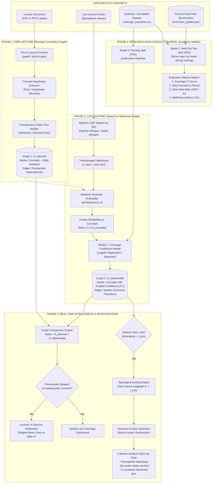
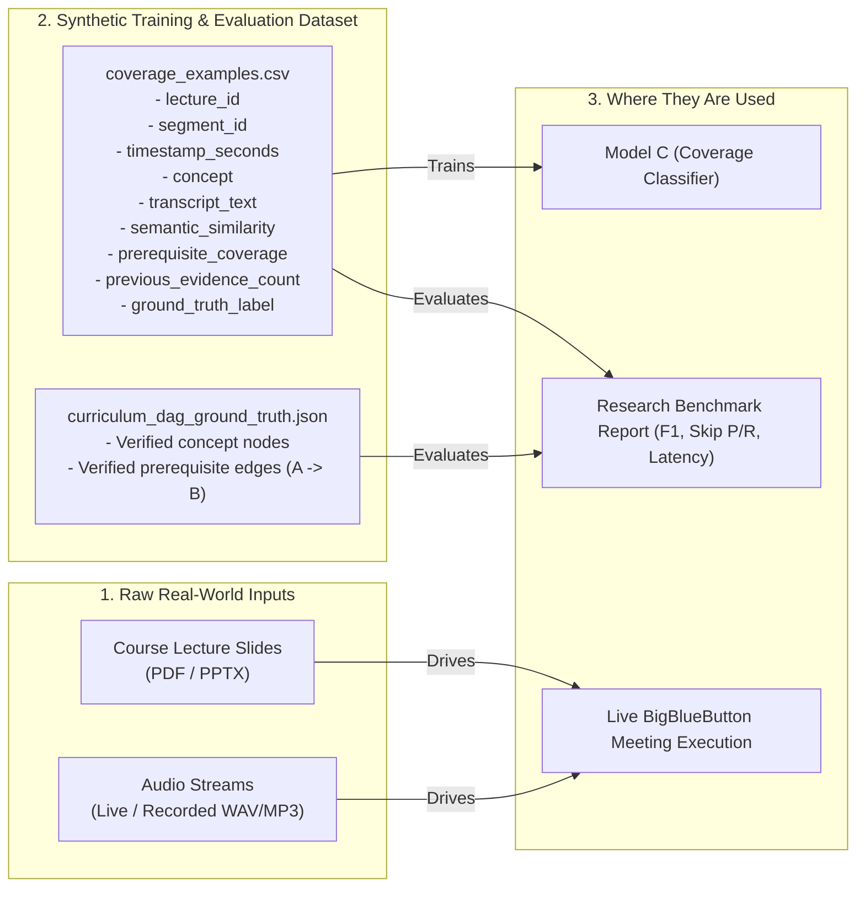

# Complete Research Flow & Model/Dataset Architecture: EduTwin C1

This document provides a complete visual diagram and reference map of the research methodology for **Component C1**, detailing every input, model, dataset, and output across both the **Offline Research/Evaluation Phase** and the **Online Runtime Phase**.

---

## 1. Master Research Architecture Diagram

The diagram below maps all datasets, pre-trained models, and trained classifiers across the entire pipeline:

---

## 2. Models Used in Component C1

Here is the exact inventory of every machine learning model in your component:

| Model ID | Model Name & Architecture | Type | Input | Output | Need Training? |
|---|---|---|---|---|---|
| **Model A** | **`faster-whisper`** (OpenAI Whisper `base` or `small`) | Pre-trained Deep ASR (Encoder-Decoder Transformer) | Raw 16kHz audio waveform | Timestamped utterance text: `[start, end, text]` | **No** (Pre-trained on 680,000 hrs of audio) |
| **Model B** | **`all-MiniLM-L6-v2`** (Sentence-Transformers) | Pre-trained Dense Bi-Encoder (MiniLM BERT) | Spoken utterance + Concept definitions | 384-dimensional dense vectors & Cosine similarity scores | **No** (Pre-trained on 1B+ sentence pairs) |
| **Model C** | **`Coverage Confidence Classifier`** (TF-IDF + Features + Logistic Regression) | Supervised Feature Classifier / Bayesian Accumulator | `[similarity, duration, prereq_ratio, mention_count, text]` | Graded coverage label (`not_yet_observed`, `introduced`, `adequately_covered`) & confidence score $[0.0, 1.0]$ | **YES** (Trained locally in seconds on your dataset) |
| **Algorithm D** | **`Topological Graph Sorter`** | Graph Algorithm (Kahn's / DFS on DAG) | Missed subgraph from $G_{\text{delivered}}(t_{\text{join}})$ | Prerequisite-ordered linear study sequence | **No** (Deterministic discrete graph algorithm) |

---

## 3. Datasets Used in Component C1

There are four distinct datasets/data artifacts across the lifecycle:

### Dataset Specifications:

#### 1. Input Lecture Documents (PDF / PPTX)
- **Role:** Uploaded before class by the lecturer.
- **Contents:** Slide titles, bullet points, code snippets, visual explanations.
- **Used by:** Phase 1 to construct $G_{\text{planned}}$.

#### 2. Live Audio Stream (Speech Utterances)
- **Role:** Captured live during the BigBlueButton meeting.
- **Contents:** Spoken audio stream segmented by Voice Activity Detection (VAD).
- **Used by:** Model A (Whisper) to produce speech segments.

#### 3. `coverage_examples.csv` (Annotated Utterance Dataset)
- **Role:** The primary ML research dataset.
- **Contents:** Thousands of utterance segments annotated with human (or synthetic) ground truth labels:
  - Features: `semantic_similarity`, `prerequisite_coverage`, `previous_evidence_count`, `timestamp_seconds`.
  - Target Label: `not_yet_observed`, `introduced`, `adequately_covered`, `insufficiently_covered`.
- **Used by:** Model C training split and test evaluation split.

#### 4. `curriculum_dag_ground_truth.json` (Curriculum Benchmark)
- **Role:** Gold-standard prerequisite graphs for 3–5 sample university courses (e.g. Data Structures, Calculus, Physics).
- **Contents:** Exact list of concepts, their slide numbers, and verified prerequisite edges ($A \to B$).
- **Used by:** Graph Comparison Engine and Skip-Detection Precision/Recall evaluation.

---

## 5. End-to-End User Experience Summary

1. **Before Meeting:**
   The lecturer uploads `Lecture04_Trees.pdf`.
   The system instantly builds **Graph 1 ($G_{\text{planned}}$)**.
2. **During Meeting (Lecturer View):**
   The lecturer teaches. The system transcribes speech with **Whisper**, maps meaning with **MiniLM**, and updates **Graph 2 ($G_{\text{delivered}}$)** with confidence scores.
   If the lecturer jumps to slide 10 without teaching the concept on slide 4, the **Graph Comparator** triggers a notification: *"Warning: You skipped 'Binary Tree Traversals' before introducing 'BST Balancing'."*
3. **During Meeting (Late-Joining Student View):**
   A student joins at minute 25.
   The **Topological Sorter** extracts what was taught in minutes 0–25, formats a **5-minute micro-lesson**, links to the exact **30-second audio replay timestamps**, and gives a **2-question quiz**. Once completed, the student is seamlessly synced into the live class!
