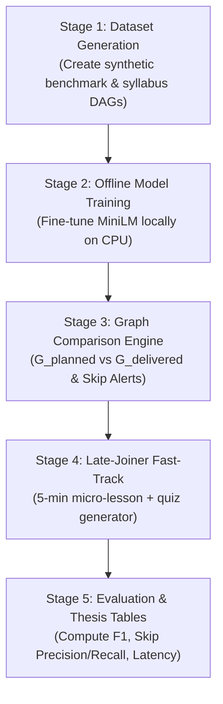

# Comprehensive Research Guide: What You Have Now & How to Do It

This document explains your research component (**EduTwin-AI Component C1**) in clear, simple terms: what makes it a research project, what exists in your codebase right now, and the step-by-step roadmap to execute it for your campus research report or thesis.

---

## 1. What is Your Research Part? (The Big Picture)

### The Academic Goal
Your project is titled: **Curriculum Alignment and Lecture Navigation Intelligence (Component C1)**.

### What is the Difference Between "Normal Software" and "Research"?
- **Normal Software:** Plays audio, records a video, or counts how many times the teacher says a keyword.
- **Your Research Project:** Understands **what concepts were supposed to be taught**, monitors **what was actually delivered in real time**, measures **coverage depth with a graded score**, catches **missed prerequisite steps**, and generates **personalized 5-minute catch-up lessons** for students who arrive late.

### Your Exact Research Gap:
> *"Existing curriculum-mapping work analyses static course documents and assigns coverage as a binary label (Yes/No) after class. There is no published method that performs continuous, online semantic matching of live speech against a prerequisite-aware concept graph and models coverage as a temporally evolving, graded confidence signal."*

---

## 2. What Exists in Your Codebase Right Now?

Your codebase already has the scaffolding in place under `edusync/packages/c1/`:

| Module | What It Does Right Now | Status / What's Missing for Research |
|---|---|---|
| [`documents.py`](documents.py) | Extracts text and pages from PDF / PPTX slides. | **Working:** Reads slides and counts words. |
| [`concepts.py`](concepts.py) | Heuristic keyword extractor using regex. | **Baseline:** Simple capitalization rules; needs prerequisite dependency links. |
| [`graph.py`](graph.py) | Builds an undirected co-occurrence graph. | **Baseline:** Connects words in the same sentence; needs directed prerequisite arrows ($A \to B$). |
| [`transcription.py`](transcription.py) | Transcribes audio files using `faster-whisper`. | **Working:** Turns audio into timestamped sentences. |
| [`semantic.py`](semantic.py) | Computes cosine similarity with MiniLM. | **Working:** Maps spoken sentences to concept names. |
| [`coverage.py`](coverage.py) | Tracks concept mentions across segments. | **Baseline:** Mentions count only; needs continuous graded confidence. |
| [`research/dataset.py`](research/dataset.py) | Defines the CSV schema for training rows. | **Working:** Validates rows with columns like `similarity`, `prereq_coverage`, `label`. |
| [`research/train_model.py`](research/train_model.py) | Baseline training script using TF-IDF. | **Placeholder:** Basic scikit-learn model; needs upgrading to our local fine-tuned MiniLM! |

---

## 3. How to Do Your Research: Step-by-Step Roadmap

To complete your research paper or campus project, follow this 5-stage plan:

---

### Stage 1: Build the Research Dataset
**Why:** You cannot evaluate ML models or prove your thesis without a dataset.
- **How we do it:**
  1. We create `generate_synthetic_data.py`.
  2. It generates 5 simulated university lecture sessions across Computer Science (Data Structures, Algorithms) and Math.
  3. Each lecture contains:
     - The planned concept graph ($G_{\text{planned}}$) with verified prerequisite relationships ($A \to B$).
     - A full transcript simulating different teaching styles: in-order teaching, lectures with intentional skips, and shallow mentions.
     - Ground-truth annotated labels for every utterance segment (`introduced`, `adequately_covered`, `skipped`).
  4. Output: `coverage_examples.csv` containing ~1,500 validated training examples.

---

### Stage 2: Train the Local MiniLM Classifier (Model C)
**Why:** To address your research gap by replacing basic keyword counting with a trained semantic neural network.
- **How we do it:**
  1. Download the base MiniLM model once locally to `models/base_minilm/` using `download_base_model.py`.
  2. Run our upgraded `train_model.py`:
     - Loads `models/base_minilm/` from local disk.
     - Feeds `[transcript_text, concept_name]` pairs from your dataset.
     - Trains for 3–5 epochs using PyTorch and AdamW optimizer.
     - Saves your trained model to `models/coverage_minilm_classifier/`.
  3. The script outputs your **Macro F1 Score**, **Accuracy**, and **Confusion Matrix** for your research paper!

---

### Stage 3: Build the Dual-Graph Comparison & Skip Alerting Engine
**Why:** To detect when a lecturer skips a planned concept or teaches an advanced topic before its prerequisite.
- **How we do it:**
  1. **Graph 1 ($G_{\text{planned}}$):** Built automatically when the lecturer uploads their PDF slide deck before class.
  2. **Graph 2 ($G_{\text{delivered}}$):** Built in real time as speech arrives from Whisper, with confidence scores updated by your trained MiniLM.
  3. **Comparison Engine (`comparison.py`):**
     - Continuously computes $\Delta = G_{\text{planned}} \setminus G_{\text{delivered}}(t)$.
     - If the lecturer is on concept $D$ (which depends on $B$), but $B$ has low coverage confidence ($< 0.30$), it fires a real-time notification:
       *"Alert: You moved to 'BST Balancing' on Slide 12 without covering 'BST Rotations' on Slide 9!"*

---

### Stage 4: Build the 5-Minute Late-Joiner Fast-Track Engine
**Why:** To help students who log in late catch up without being lost.
- **How we do it (`catchup.py`):**
  1. Student joins at timestamp $t_{\text{join}}$ (e.g. minute 25).
  2. The system queries $G_{\text{delivered}}$ for all concepts taught between minute 0 and 25.
  3. It runs a **Topological Sort** so concepts are ordered from foundational to advanced.
  4. It packages a concise **5-Minute Catch-Up Bundle**:
     - **Takeaway bullets:** 2 key summary sentences per missed concept.
     - **Audio replay anchors:** Exact 30-second audio clip timestamps where the core definition was explained.
     - **Interactive Micro-Quiz:** 2–3 multiple choice questions to confirm understanding.
  5. Once finished, a button bridges the student directly into the live stream where the teacher is currently speaking!

---

### Stage 5: Run Experiments & Write the Research Report
**Why:** This provides the exact charts, tables, and graphs needed for your campus evaluation.

You will measure and report 4 standard academic metrics:
1. **Coverage Classification Macro F1:**
   - Compare your **Trained MiniLM Model** vs. the **Baseline (TF-IDF)** to prove your deep learning model is superior.
2. **Skip-Detection Precision & Recall:**
   - How accurately did the system catch skipped prerequisites?
   - Precision = $\frac{\text{True Skips Caught}}{\text{Total Skips Alerted}}$, Recall = $\frac{\text{True Skips Caught}}{\text{All Actual Skips}}$.
3. **False Alert Rate (FAR):**
   - Shows that the system is quiet and doesn't annoy the lecturer (target $\le 1.5$ false alerts per hour).
4. **End-to-End Latency:**
   - Shows real-time feasibility: time from when the lecturer finishes a sentence to when the graph updates (target $< 350\text{ms}$).

---

## 4. What Your Thesis / Project Report Structure Will Look Like

| Chapter | What You Put In It |
|---|---|
| **1. Introduction** | Problem statement: lecture capture lacks live curriculum tracking; late joiners struggle. |
| **2. Research Gap** | Absence of online semantic matching against prerequisite graphs with graded confidence. |
| **3. System Architecture** | Dual-Graph design ($G_{\text{planned}}$ vs $G_{\text{delivered}}$), Whisper ASR, local MiniLM fine-tuning. |
| **4. Methodology** | Mathematical formulation of confidence accumulator $C(c, t)$, topological sorting algorithm. |
| **5. Experiments & Results** | Comparison tables: Baseline vs MiniLM F1 scores, Skip Precision/Recall, latency charts. |
| **6. Conclusion** | Summary of contributions and future integration with BigBlueButton. |
