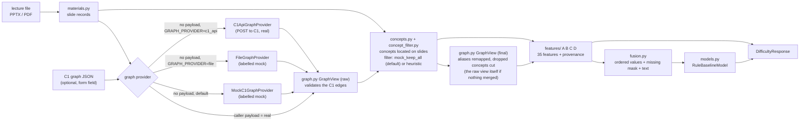

# C2 pre-lecture difficulty pipeline (Phase 1)

Design document for the difficulty half of component C2. Code: [`edusync/packages/c2`](../../edusync/packages/c2),
module `edusync_c2.difficulty`. Related: [architecture](architecture.md), [C1 -> C2 graph contract](c1-c2-graph-contract.md),
[package README](../../edusync/packages/c2/README.md).

> Status words used throughout: **real** = computed from real input; **mock** = placeholder that is labelled as such in
> every response; **TODO** = not built. Nothing here is a trained model and no accuracy is claimed.

## 1. Purpose and scope

C2 has two stages:

1. **Pre-lecture difficulty prediction** (this document, Phase 1): from the lecture file (PPTX or PDF, the same file
   C1 processed) and, optionally, C1's concept graph, predict a difficulty label (Low / Medium / High) per concept
   **before the lecture happens**.
2. **Live comprehension validation** (later, Phase 5): compare the predicted difficulty with poll/quiz evidence during
   the lecture. A rule-based placeholder exists (`comprehension.py`, `POST /api/c2/comprehension/evaluate`); it is not
   part of the Phase 1 work and has not been validated against real polls.

Phase 1 builds the **whole pipeline end to end**, with the hard parts mocked or marked TODO, so that each part can be
replaced one at a time without changing the response shape. What exists:

- a parser for PPTX and PDF lecture files;
- a way to accept C1's graph (as a request payload) or build a clearly labelled mock graph from slide titles;
- 35 registered features in four groups (A = 8, B = 7, C = 7, D = 13), all 35 implemented (18 computed from the lecture text, 9 from PPTX structure only, 8 from the C1 graph), no mock and no planned feature left (see section 4; the six slide-geometry features of group D became real in Phase 2, milestone M3, see "Feature D method"; the vocabulary features of group A in milestone M1, see "Feature A method"; the three semantic features of group C in milestone M4, see "Feature C method", and they are `unavailable` unless the opt-in semantic scorer is on; the other features pre-registered in schema version 0.3 were built without a schema change, see "Schema versioning policy");
- ordered, mask-aware fusion input;
- a transparent rule baseline (`RuleBaselineModel`) that produces a label and a raw score, with no probabilities and no
  confidence;
- an API route and a deterministic synthetic data generator for tests.

What does **not** exist: a trained model, a labelled dataset, a verified C1 connection at runtime (the `c1_api` provider exists but is off by default and has only met C1's v0 output), persistence, any
evaluation of prediction quality, and the live stage.

## 2. Architecture



Flow in `difficulty/pipeline.py` (`DifficultyPipeline.run`):

1. `materials.parse_materials` turns the upload into `SlideRecord`s (title, text, notes, paragraphs with bullet level,
   picture/chart/table/shape counts, formula and code hints). PDF yields text per page only.
2. The graph comes from `PayloadGraphProvider` when the caller supplied `c1_graph` (a real input, not verified by C2),
   otherwise from the provider configured by `EDUSYNC_C2_GRAPH_PROVIDER` (`file` or `c1_api`, see "Graph providers"),
   and by default from `MockC1GraphProvider` (concepts = slide titles, prerequisites = slide order, labelled mock).
3. `GraphView(response)` validates the C1 edges on the raw ids (the "raw view"; the `graph` log line reports these raw
   counts). `concepts.build_concepts` then takes concepts from the C1 nodes (fallback: the C1 `concepts` list), locates
   each one on the slides (whole-phrase, case-insensitive match of label or id in title or text) and passes them through
   the concept filter, selected by `EDUSYNC_C2_CONCEPT_FILTER`. The default `MockConceptFilter` keeps all of them;
   `HeuristicConceptFilter` drops generic slide phrases and merges aliases (see "Concept filter").
   If anything was merged or dropped, a second `GraphView` (the "final view") is built with the alias map and the
   dropped ids; otherwise the final view is the raw view object itself.
4. `features.compute_all_features` produces all 35 features for each concept (kept canonical concepts only), using the
   final view, each with a status and a source.
5. `fusion.build_fusion_input` orders the features by registry, marks unavailable (and, by default, mocked) ones as
   missing, and builds the concept text (concept label + description + slide text, max 1500 characters).
6. The model predicts a label per concept (`None` when too few features were computed).
7. The response carries the inputs, a status per stage, the model info, the predictions and the TODO list.

The pipeline is deterministic: the response contains no timings, clocks or random ids.

## 3. Module map

All paths are under `edusync/packages/c2/src/edusync_c2/`.

| File | Purpose |
|------|---------|
| `router.py` | HTTP routes: `/difficulty`, `/difficulty/info`, `/health`, `/comprehension/evaluate` |
| `comprehension.py` | Rule-based poll/quiz flagging (later stage, unchanged by Phase 1) |
| `schemas.py` | Request/response models of the comprehension route |
| `difficulty/schemas.py` | All Phase 1 contracts: C1 graph input, slide/concept/feature records, fusion, model output, `DifficultyResponse` |
| `difficulty/materials.py` | PPTX/PDF parser, upload validation (`MaterialsError`), formula and code detectors |
| `difficulty/geometry.py` | Pure integer-EMU helpers for the parser: rotation swap, group transform, box clipping, union area (cap `MAX_UNION_SHAPES = 200`) |
| `difficulty/graph.py` | `GraphView`: valid prerequisite edges and per-concept metrics; optional `aliases` and `dropped` arguments remap edges to canonical concepts and cut dropped ones |
| `difficulty/providers.py` | Graph providers: `PayloadGraphProvider`, `MockC1GraphProvider`, `C1ApiGraphProvider` (per request, off by default), `FileGraphProvider` (bundled sample or a JSON file, labelled mock) |
| `difficulty/c1_client.py` | `UrllibTransport` and `build_multipart`: stdlib HTTP call to C1's `POST /lectures/graph`, errors mapped to `GraphProviderError` |
| `difficulty/errors.py` | `ModelArtifactError`, `ModelNotAvailableError`, `GraphProviderError` (carries the HTTP status) |
| `difficulty/resources/sample_c1_graph_v1.json` | Bundled synthetic v1 graph for the `file` provider (made by `scripts/make_sample_graph.py`) |
| `difficulty/concepts.py` | Concepts from graph nodes, slide alignment, `ConceptFilter` and `ContextualConceptFilter` protocols, `FilterContext`, `MockConceptFilter` (`is_mock = True`), `create_concept_filter` |
| `difficulty/concept_filter.py` | `HeuristicConceptFilter`: generic-phrase drop, normalisation merge, abbreviation merge (see "Concept filter") |
| `settings.py` | `C2Settings` (`EDUSYNC_C2_*`): log level, model, model dir, concept filter and its extras tier, graph provider, graph file, C1 base URL and timeout |
| `difficulty/registry.py` | `FEATURE_SPECS` (the 35 features, in order), `FEATURE_SCHEMA_VERSION`, `feature_schema_hash()`, `PHASE1_TODO` |
| `difficulty/features/language.py` | Group A processor and `lexical_difficulty` |
| `difficulty/features/vocab.py` | `VocabularyAnalyzer`: word-piece fragmentation, unfamiliar share and domain-term share; shared default analyzer with one cached first load |
| `difficulty/features/wordpiece.py` | Pure-Python BERT WordPiece (uncased) over the vendored MiniLM vocabulary |
| `difficulty/features/lexicon.py` | Loader and plural fold of the curated CS/IT domain lexicon |
| `difficulty/resources/` | Vendored data: `bert_uncased_vocab.txt`, `domain_terms.txt`, `semantic_prototypes.txt`, `sample_c1_graph_v1.json`, `NOTICE`, `LICENSE-APACHE-2.0.txt`, `.gitattributes` (LF line endings) |
| `difficulty/features/_common.py` | `assemble`: builds a group's feature list by registry name (planned names become unavailable `todo:` values; a missing implemented/mock name or an unknown name raises `ValueError`) |
| `difficulty/features/prerequisites.py` | Group B processor |
| `difficulty/features/explanation.py` | Group C processor (definition/example/step regexes, diagram count, and the three `expl.semantic_*` features from the optional scorer; unavailable when it is off) |
| `difficulty/features/minilm.py` | `MiniLMEncoder`: pure-numpy MiniLM forward pass over the base `model.safetensors` (safetensors reader, exact GELU, mean pooling, L2), `SemanticModelError` with a short `reason`, LFS pointer detection. numpy is imported lazily |
| `difficulty/features/semantic_loader.py` | `get_default_encoder`: process-wide, thread-safe lazy load of the encoder; success and failure are both cached; `weights_fingerprint` (the `<sha8>` in `/info`); `reset_default_encoder` for tests |
| `difficulty/features/semantic.py` | `SemanticScorer`: sentence splitting, prototype centroids, cosine scores, thresholds, per-request sentence budget (`for_request`), bounded embedding cache |
| `difficulty/resources/semantic_prototypes.txt` | The prototype sentences (12 each for `[definition]`, `[example]`, `[step]`, original wording) |
| `difficulty/features/density.py` | Group D processor (text, structure and the six geometry/visual features; `_VC_WEIGHTS`, `_VC_SATURATION`) |
| `difficulty/features/__init__.py` | `compute_all_features`: all 35 in registry order |
| `difficulty/fusion.py` | `build_fusion_input`, `to_vector`, `summarize_features` |
| `difficulty/models.py` | `DifficultyModel` protocol, `RuleBaselineModel`, `MiniLMFusionModel` (TODO) |
| `difficulty/pipeline.py` | `DifficultyPipeline`: orchestration, stage statuses, warnings |
| `difficulty/synthetic.py` | Seeded synthetic decks (PPTX/PDF), C1 graphs (v0/v1), rule labels |
| `difficulty/ids.py` | The two concept-id conventions: `casefold_id` (v0, mock, fallback) and `slug_id` (v1 hyphen slugs) |
| `scripts/make_synthetic_data.py` | CLI around `synthetic.py` (one level up, in `edusync/packages/c2/`) |
| `scripts/feature_report.py` | Per-feature report over the seeded synthetic decks; `--write-snapshot PATH` regenerates the registry snapshot (see "Schema versioning policy") |

## 4. The 35 features

Source of truth: `difficulty/registry.py`. Each feature has two registry fields:

- `maturity`: `implemented` (built), `mock` (placeholder value, labelled `mocked`) or `planned` (not built yet). The registry has no mock and no planned feature any more; the other two values stay in the schema for future features.
- `requires`: `text` (computed from the lecture text), `pptx_structure` (PPTX only; from a PDF the status is `unavailable`) or `c1_graph` (needs the C1 graph; from a mock graph the status is `mocked`).

The legacy `phase1` field (`real`, `real_needs_structure`, `graph`, `mock`, `todo`) is no longer stored. It is derived from `maturity` and
`requires` and is still in the JSON of `/difficulty/info` for one more release; it is deprecated, so read `maturity` and `requires`.

Counts: 35 implemented (18 `text`, 9 `pptx_structure`, 8 `c1_graph`), 0 mock, 0 planned. Per group: A = 8, B = 7, C = 7, D = 13, all implemented. Verified by parsing `registry.py`.

| # | Name | Group | Maturity | Requires | Description |
|---|------|-------|----------|----------|-------------|
| 1 | `lang.avg_sentence_length` | A | implemented | text | Mean words per sentence on the slides. |
| 2 | `lang.avg_word_length` | A | implemented | text | Mean letters per word on the slides. |
| 3 | `lang.long_word_ratio` | A | implemented | text | Share of words with 9+ letters (technical proxy). |
| 4 | `lang.lexical_score` | A | implemented | text | Transparent lexical difficulty heuristic in [0, 1]. |
| 5 | `lang.concept_term_density` | A | implemented | text | Concept mentions per 100 words on its slides (the label plus the labels of merged aliases, each occurrence counted once). |
| 6 | `lang.unfamiliar_vocab_ratio` | A | implemented | text | Share of words that need 2+ MiniLM word pieces (or are `[UNK]`). |
| 7 | `lang.subword_fragmentation` | A | implemented | text | Mean MiniLM word pieces per word. |
| 8 | `lang.domain_term_ratio` | A | implemented | text | Share of words in the curated CS/IT lexicon. |
| 9 | `prereq.direct_count` | B | implemented | c1_graph | Number of direct prerequisites. |
| 10 | `prereq.chain_depth` | B | implemented | c1_graph | Longest prerequisite chain below the concept. |
| 11 | `prereq.transitive_count` | B | implemented | c1_graph | All distinct (transitive) prerequisites. |
| 12 | `prereq.mean_confidence` | B | implemented | c1_graph | Mean confidence of direct prerequisites. |
| 13 | `prereq.curriculum_defined_share` | B | implemented | c1_graph | Share of direct prerequisites from the curriculum. |
| 14 | `prereq.weighted_depth` | B | implemented | c1_graph | Sum of edge confidences along the heaviest prerequisite chain below the concept (a missing confidence counts 1.0; cycle-safe like `prereq.chain_depth`; 0.0 when it has no prerequisites). |
| 15 | `prereq.dependents_count` | B | implemented | c1_graph | Number of distinct concepts that directly depend on this one (prerequisite edges only; 0.0 when none). |
| 16 | `expl.definition_count` | C | implemented | text | Definition phrases on the concept's slides. |
| 17 | `expl.example_count` | C | implemented | text | Worked-example phrases on the concept's slides. |
| 18 | `expl.step_count` | C | implemented | text | Step-by-step markers (Step 1, numbered lists). |
| 19 | `expl.diagram_support` | C | implemented | pptx_structure | Pictures + charts on its slides (PPTX). |
| 20 | `expl.semantic_support_score` | C | implemented | text | (min(definitions, 1) + min(examples, 1)) / 2 of the semantic counts; off = unavailable. Opt-in (see "Feature C method"). |
| 21 | `expl.semantic_definition_count` | C | implemented | text | Slide sentences closest to the definition prototypes (embedding based; opt-in, unavailable when the scorer is off). |
| 22 | `expl.semantic_example_count` | C | implemented | text | Slide sentences closest to the worked-example prototypes (embedding based; opt-in, unavailable when the scorer is off). |
| 23 | `dens.words_per_slide` | D | implemented | text | Mean words per concept slide. |
| 24 | `dens.concepts_per_slide` | D | implemented | text | Mean distinct C1 concepts per concept slide (kept canonical concepts only: a merged alias counts once, a dropped concept not at all). |
| 25 | `dens.formula_presence` | D | implemented | text | Share of concept slides that look like formulas. |
| 26 | `dens.code_presence` | D | implemented | text | Share of concept slides that look like code. |
| 27 | `dens.max_bullet_depth` | D | implemented | pptx_structure | Deepest bullet level on its slides (PPTX). |
| 28 | `dens.shape_count_mean` | D | implemented | pptx_structure | Mean shapes per concept slide (PPTX). |
| 29 | `dens.concept_frequency` | D | implemented | c1_graph | C1 node frequency of the concept. |
| 30 | `dens.visual_complexity` | D | implemented | pptx_structure | 0-1 heuristic: 0.35 sat(media, 4) + 0.25 sat(diagram, 15) + 0.25 visual area + 0.15 sat(info, 30), weights renormalised over known components (see "Feature D method"). |
| 31 | `dens.text_area_ratio` | D | implemented | pptx_structure | Mean share of slide area covered by shapes with text (union, clamped 0-1). |
| 32 | `dens.picture_area_ratio` | D | implemented | pptx_structure | Mean share of slide area covered by pictures (union, clamped 0-1). |
| 33 | `dens.min_font_pt` | D | implemented | pptx_structure | Smallest explicit font size on the concept's slides, in points (inherited sizes are never read). |
| 34 | `dens.diagram_element_count` | D | implemented | pptx_structure | Mean diagram elements (autoshapes, connectors, freeforms, SmartArt) per concept slide. |
| 35 | `dens.table_cell_count` | D | implemented | pptx_structure | Mean table cells (rows x columns) per concept slide. |

Groups: A = technical vocabulary and language complexity, B = prerequisite and concept complexity, C = explanation and
example support, D = information density and structure.

Features were pre-registered (schema 0.3) so that the schema (names, groups, order) is complete before any model is trained; milestones only changed their maturity, not the schema. None is `planned` any more. If a future feature is registered as `planned`, it is `unavailable` with source `todo:<name>` and the note "not yet implemented", never `mocked`, because fusion can treat a mock as usable. Planned features are not read by the baseline model.

Notes on the real features: they are regex and counting heuristics (the three vocabulary features count word pieces and lexicon hits, and the three semantic features compare sentence embeddings with prototypes, see below) over the text of the slides that mention the
concept (`definition`/`example`/`step` cues in `features/explanation.py`; formula and code hints in `materials.py`).
They are cheap proxies, not measurements of how a student experiences the slide.

### Feature A method (vocabulary, Phase 2 milestone M1)

Three group A features measure vocabulary. They replace the earlier 0.0 placeholder of `lang.unfamiliar_vocab_ratio`
and add two siblings (24 features became 26 in schema version 0.2; group A has 8 features since then; with the nine pre-registered planned features of 0.3 the group sizes are A = 8, B = 7, C = 7, D = 13). The five other group A
features are untouched and keep their regex word rule (`[A-Za-z][A-Za-z'-]*`).

| Feature | Definition | Range |
|---------|------------|-------|
| `lang.unfamiliar_vocab_ratio` | share of words that need `MIN_PIECES_UNFAMILIAR = 2` or more word pieces, or are `[UNK]` | 0..1 |
| `lang.subword_fragmentation` | mean word pieces per word (`[UNK]` counts as 1 piece) | >= 1.0 |
| `lang.domain_term_ratio` | share of words in the curated CS/IT lexicon | 0..1 |

Order inside group A (registry order): the five old features, `lang.unfamiliar_vocab_ratio`, then
`lang.subword_fragmentation` and `lang.domain_term_ratio`. Adding two features changed the registry order and
`feature_schema_hash()` (schema version 0.1 became 0.2); no trained model artifact exists yet, so nothing recorded the old hash.

**Word rule (the three new features only).** Words are runs of Unicode letters (`[^\W\d_]+`), so hyphens, apostrophes,
digits and underscores split words ("real-time" is two words, "don't" is "don" and "t", which is ignored). Words with
fewer than 2 letters are ignored. Each word is lowercased before lookup; the tokenizer also strips accents.

**Tokenizer.** A pure-Python BERT WordPiece (uncased) in `features/wordpiece.py` over the MiniLM vocabulary, vendored as
`difficulty/resources/bert_uncased_vocab.txt` (30,522 entries; SHA-256
`07eced375cec144d27c900241f3e339478dec958f92fddbc551f295c992038a3`; source `sentence-transformers/all-MiniLM-L6-v2`, revision
`1110a243fdf4706b3f48f1d95db1a4f5529b4d41`; Apache License 2.0). `NOTICE` and `LICENSE-APACHE-2.0.txt` sit beside it, and
a nested `.gitattributes` keeps the file LF-only so the hash is stable on Windows checkouts. The file is an unmodified
copy; no model weights are included and no dependency was added. A word of more than 100 characters, or one the greedy
longest-match cannot segment, becomes `[UNK]`. Parity with the Hugging Face `tokenizers` library is checked on 53 inputs
(accents, CJK, emoji, code, URLs, acronyms, 99/100/101-character words): `tests/difficulty/golden/wordpiece_pieces.json`
is the committed result (written by `scripts/make_wordpiece_golden.py`, which needs `tokenizers`), so CI checks parity
without that library; a test marked `ml` compares against the library live.

**Lexicon.** `difficulty/resources/domain_terms.txt` holds 851 single-word lowercase terms and acronyms of computer
science, IT and machine learning, written for this project (not copied from a glossary; the header says so). A word
counts if it is in the list, or after stripping a trailing `es` or `s` (not `ss`) it is ("databases", "indexes").

**Statuses.**

| Case | Result |
|------|--------|
| Concept not found on any slide | all eight group A features `unavailable`, note "concept not found in materials" |
| Slides found, no words (regex rule of the old five features) | all eight `unavailable`, note "no words on the concept's slides" |
| Words exist, but none under the new word rule (for example only one-letter words) | the three vocabulary features `unavailable`, note "no words for vocabulary analysis" |
| Vocabulary resources missing or unreadable | the three vocabulary features `unavailable`, note "vocabulary resources unavailable"; one WARNING `vocab_unavailable` per process; never an exception |
| Otherwise | all three `computed`; `source` is `materials:wordpiece` (unfamiliar ratio, fragmentation) or `materials:lexicon` (domain ratio) |

The old mocked 0.0 is gone, so `lang.unfamiliar_vocab_ratio` is never `mocked` any more. The analyzer is built once per
process under a lock and shared by the pipeline's worker threads; a load failure is cached too (restart the process to
retry). `DifficultyPipeline(vocab=...)` and `compute_all_features(..., vocab=...)` accept an injected analyzer. Logging:
see the `vocab_loaded` and `vocab_unavailable` events below; no slide text or words are logged.

**Illustrative fixture values.** Hand-written paragraphs of 61 to 67 words in `tests/difficulty/test_vocab.py`
(`EASY`, `MEDIUM`, `HARD`). These are illustrative fixture values, not a validation:

| Text | `lang.subword_fragmentation` | `lang.unfamiliar_vocab_ratio` | `lang.domain_term_ratio` |
|------|------------------------------|-------------------------------|--------------------------|
| easy (everyday narrative) | 1.0 | 0.0 | 0.0 |
| medium (database basics) | 1.044776 | 0.044776 | 0.059701 |
| hard (machine learning and cryptography jargon) | 1.557377 | 0.344262 | 0.295082 |

**Limits, stated plainly.**

- The features measure general-English rarity (via the MiniLM vocabulary) plus listed jargon. They do not measure
  pedagogical difficulty or how a student experiences the slides.
- `MIN_PIECES_UNFAMILIAR = 2` and the lexicon are unvalidated choices; no labelled data was used to set them.
- Inflection adds noise: "minimizes" needs 2 pieces and counts as unfamiliar although it is an ordinary word.
- The tokenizer alone misses most jargon. In a feasibility check on technical words only about 21% had 3 or more
  pieces; many (encryption, gradient, authentication, kernel, database) are single tokens. That is why the lexicon is a
  separate feature and is not folded into the tokenizer feature.
- The lexicon is CS/IT/ML-oriented and will not fit every course; for other subjects `lang.domain_term_ratio` is
  mostly 0 and says little.
- The seeded synthetic decks are almost constant for these features (about 96% of their words are single tokens), so
  they must not be used to judge them. Use the fixtures above or real lecture text instead.
- The baseline model weights are unchanged and the baseline scores and labels of the synthetic decks are identical to
  before; `tests/difficulty/test_baseline_golden.py` proves it.

Tests: `test_wordpiece.py`, `test_lexicon.py`, `test_vocab.py`, `test_vocab_resources.py`, `test_features_language.py`
under `edusync/packages/c2/tests/difficulty/`.

### Feature C method (semantic definition and example detection, Phase 2 milestone M4)

Three group C features compare slide sentences with prototype sentences using a sentence embedding:
`expl.semantic_definition_count`, `expl.semantic_example_count` and `expl.semantic_support_score`. The scorer is **opt-in and
off by default** (`EDUSYNC_C2_SEMANTIC=off`), so a default deployment, its responses and its tests do not change. The regex
counts (`expl.definition_count`, `expl.example_count`, `expl.step_count`) stay as they are and remain separate features:
semantic and regex values are never mixed or substituted for each other.

**Encoder** (`features/minilm.py`). A pure-numpy forward pass of all-MiniLM-L6-v2 over the repo's base weights
(`packages/blueprint_model/artifacts/base/sentence-transformers--all-MiniLM-L6-v2/model.safetensors`, 90.9 MB). No torch,
no sentence-transformers and no new package: the file is read directly (8-byte header length, JSON header, raw float32
tensors via numpy). It has 6 transformer layers with post-LayerNorm and absolute positions, the exact (erf) GELU, mean pooling
over all tokens and L2 normalisation. Tokenization uses the vendored MiniLM vocabulary (`features/wordpiece.py`) with
`[CLS]`/`[SEP]` added, at most 128 tokens per text (longer text is cut). Every text is encoded on its own (no batching, no
padding), so a text gets the same vector alone or inside any batch: the encoder is deterministic per text. numpy is imported
lazily, so `import edusync_c2` never needs it.

**Reference check.** The encoder was compared with the real sentence-transformers model on 7 fixed sentences; the cosine
between the two embeddings is at least 0.9999 for every sentence. The reference vectors were produced once in a throwaway
Docker container with torch and committed as `tests/difficulty/golden/minilm_reference.json` (model
`sentence-transformers/all-MiniLM-L6-v2`, revision `1110a243fdf4706b3f48f1d95db1a4f5529b4d41`, rounded to 6 decimals). The
comparison test is `test_minilm.py::test_real_model_matches_reference_embeddings`, marked `ml`; it is deselected in CI and skipped
when the weights are missing or a Git LFS pointer. Other tests use a tiny synthetic model checked against an independent
reference implementation.

**Prototypes and scoring** (`features/semantic.py`, `resources/semantic_prototypes.txt`). The resource file holds 12
original-wording sentences for each of three classes: `[definition]`, `[example]`, `[step]`. Each class is embedded once and
averaged into a unit-length centroid when the scorer is built. A slide sentence is scored by its cosine to each centroid,
rounded to 4 decimals. A sentence counts as a **definition** when its definition cosine is at least the definition threshold and
higher than its example cosine, and as an **example** under the mirrored rule; a tie counts for neither, so no sentence is
counted twice. The step centroid is scored but no feature counts steps semantically (the regex `expl.step_count` is unchanged).

**Thresholds are unvalidated.** An earlier feasibility check used 65 hand-written sentences (12 prototypes per class, centroid
cosine). It gave AUC 0.96 for definitions, 0.97 for steps and 0.81 for examples, with useful thresholds around 0.21 to 0.25.
That is a feasibility signal, not a benchmark: the sentences were hand-written for the check, no lecturer labels were involved,
and example detection is the weakest class. 0.23 is a heuristic default for both thresholds, and both are settings so they can
be changed without code.

**Sentence handling.** The text of a concept is the text and notes of its slides (the title is already part of the text). It is split
on `.`, `!`, `?` and line breaks; a leading bullet or list number is removed; only sentences of 3 to 80 words are kept. Duplicates
(compared case-insensitively) are dropped in input order, so the first occurrence is kept. Embeddings are cached by sentence
text (bounded, 5000 entries), so a sentence repeated across concepts or requests is encoded once. A per-request budget
(`EDUSYNC_C2_SEMANTIC_MAX_SENTENCES`, default 400) limits the number of distinct sentences scored in one request. Sentences beyond
it are not scored, the affected features carry the note "sentence budget reached: later sentences were not scored", the counts
are then lower bounds, and the response gets one warning ("semantic scorer sentence budget reached: ..."), with a
`semantic_truncated` log line. The budget bounds CPU time on large decks.

**Features and statuses.**

| State | The three `expl.semantic_*` features |
|-------|--------------------------------------|
| `EDUSYNC_C2_SEMANTIC=off` (default) | `unavailable`, source `semantic:off`, note "semantic scorer is off"; no warning |
| `minilm`, scorer works | `computed`, source `semantic:minilm`; the counts are numbers of sentences, the score is `(min(definitions, 1) + min(examples, 1)) / 2`, so it is 0, 0.5 or 1 |
| `minilm`, weights missing, an LFS pointer, corrupt or incompatible, or no model folder set | `unavailable`, source `semantic:minilm`, note "semantic scorer unavailable"; one response warning "semantic scorer unavailable: semantic features are unavailable"; HTTP status stays 200 |
| concept not found on any slide | `unavailable`, source `materials:regex`, note "concept not found in materials" (like the rest of group C) |

A feature that cannot be computed is never a fake 0.0 and never filled with the regex value. `FusionFeature` has no source field,
so mixing the two would silently change the meaning of one column; the two stay separate features.

**Settings** (all read from the environment, see `settings.py`).

| Variable | Values | Default | Meaning |
|----------|--------|---------|---------|
| `EDUSYNC_C2_SEMANTIC` | `off`, `minilm` | `off` | Switches the semantic scorer |
| `EDUSYNC_C2_SEMANTIC_MODEL_DIR` | folder path | unset | Folder with `model.safetensors` and `config.json` (the base MiniLM folder); an empty value counts as unset |
| `EDUSYNC_C2_SEMANTIC_DEF_THRESHOLD` | 0 to 1 | `0.23` | Minimum definition cosine (unvalidated) |
| `EDUSYNC_C2_SEMANTIC_EX_THRESHOLD` | 0 to 1 | `0.23` | Minimum example cosine (unvalidated) |
| `EDUSYNC_C2_SEMANTIC_MAX_SENTENCES` | integer >= 1 | `400` | Per-request sentence budget |

**Loading and failure** (`features/semantic_loader.py`). The encoder is loaded lazily on the first request and shared by the whole
process, once even under a thread race. A failure is cached too, so a missing model costs one attempt and one WARNING, not one per
request. The cause is a short `reason` (`missing`, `lfs_pointer`, `corrupt`, `incompatible`, or an exception class name). A
failure while embedding the prototypes logs `semantic_unavailable reason=prototype_encoding`. A failure while scoring a request
(an unexpected encoder error or a wrong shape) is raised as `SemanticScoringError` and answered with HTTP 503 and the fixed
message `semantic scorer failed`; the message never contains slide text, and the original exception is only chained. The next
request is served normally again.

**`/info`.** `GET /api/c2/difficulty/info` reports `semantic_scorer`: `off`, `minilm:<sha8>` (the first 8 hex characters of
sha256 over the first 1 MiB of the weights plus their size) or `minilm:unavailable`.

**Docker.** The weights are Git LFS files, and the runtime image contains no packages directory, so they are mounted as a volume.

1. On the host, in the repo: `git lfs pull`. Without it `model.safetensors` is a small pointer file and the scorer reports
   `lfs_pointer`.
2. Mount the model folder read-only and set the variables (the image already has numpy):

```bash
docker run ... \
  -v <host>/packages/blueprint_model/artifacts/base/sentence-transformers--all-MiniLM-L6-v2:/models/minilm:ro \
  -e EDUSYNC_C2_SEMANTIC=minilm \
  -e EDUSYNC_C2_SEMANTIC_MODEL_DIR=/models/minilm \
  -e OPENBLAS_NUM_THREADS=4 \
  ...
```

   A compose service takes the same volume and variables. This is documentation only; no compose file or Dockerfile is changed.
3. Check `GET /api/c2/difficulty/info`: `semantic_scorer` should be `minilm:<sha8>`.

Set `OPENBLAS_NUM_THREADS=4`. With the default threading on a 16-core machine, encoding took 136 to 196 ms per sentence; with 1 to 4
threads it took about 17 to 24 ms.

**Measured** (one developer machine and the C2 container; not a benchmark): the weights load in 0.12 s; embedding the 36 prototypes
(once per pipeline build, at the first request) took about 7.5 s with default threading and much less with
`OPENBLAS_NUM_THREADS=4`. In the container with the weights mounted, the first request took 1.6 s and a repeat 0.03 s, with an
identical response. With the weights not mounted, the request answers 200 with the warning and unavailable features. With
`EDUSYNC_C2_SEMANTIC=off` nothing is loaded. Latency and memory with the Whisper model loaded in the same container were not
re-measured.

**Baseline guarantee.** The rule baseline reads only the three regex support features (`SUPPORT_FEATURES` in `models.py`), never the
`expl.semantic_*` features. Tests show that predictions (labels and scores) are identical with a scorer on (fake encoder) and
off (`test_semantic_wiring.py::test_support_features_are_the_three_regex_ones` and `test_baseline_prediction_ignores_the_scorer`,
`test_semantic_reporting.py::test_baseline_output_is_unchanged_by_the_scorer`). In `test_baseline_golden.py`,
`expl.semantic_support_score` is in the explicit `EXCLUDED` set: the stored golden has `[0.0, "mocked"]`, and the feature is now
`unavailable` by default. Scores, labels and all other features are still compared. The feature names, groups and order did not
change, so the schema hash and `FEATURE_SCHEMA_VERSION` (0.3) are unchanged (maturity is not hashed).

**Determinism and privacy.** Sentences are split and de-duplicated in order, each text is encoded alone, scores are rounded, and
the output depends on the weights only. Logs carry the weights fingerprint, reasons and the limit, never slide text.

**Known limits.**

- The thresholds are unvalidated; the 65-sentence check is a feasibility signal only. Example detection is the weakest (AUC 0.81).
- English only: the vocabulary and the prototypes are English.
- Sentence level, not concept level: the features count sentences on the concept's slides that look like a definition or an
  example. They do not check that a sentence defines that concept, or that an example is correct.
- The prototype sentences are original wording; a different set would move the scores.
- CPU latency grows with the number of distinct sentences; the per-request budget bounds it, at the price of lower-bound counts.
- No model uses the features yet: the baseline ignores them and no trained model exists. Whether they help is a Phase 3 question.

Tests: `test_minilm.py` (reader, GELU/erf, tiny model, reference embeddings), `test_semantic_loader.py` (lazy load, failure caching,
LFS pointer, thread race), `test_semantic.py` (splitting, prototypes, cosine, counting, budget, cache),
`test_semantic_wiring.py` (settings, pipeline, router, baseline guard) and `test_semantic_reporting.py` (`/info`, warnings,
503, privacy, determinism).

### Feature D method (slide geometry, fonts, diagrams; Phase 2 milestone M3)

Six group D features read the slide structure of a PPTX. They were `planned` (`dens.visual_complexity` had a TODO note);
they are `implemented` now. Maturity is not hashed, so names, groups, order, the schema hash and `FEATURE_SCHEMA_VERSION`
(`0.3`) are unchanged. Each value is the mean over the concept's slides that have a value (the minimum for `dens.min_font_pt`).

| Feature | Definition | Range |
|---------|------------|-------|
| `dens.text_area_ratio` | union area of the shapes that hold non-empty text (title and table frames included, pictures not) divided by the slide area, clamped to [0, 1] | 0..1 |
| `dens.picture_area_ratio` | union area of `Picture` and `PlaceholderPicture` shapes divided by the slide area, clamped | 0..1 |
| `dens.min_font_pt` | smallest explicit font size of a non-blank text run, in points | > 0 |
| `dens.diagram_element_count` | mean number of diagram leaves per slide | >= 0 |
| `dens.table_cell_count` | mean rows x columns per slide, merged cells included | >= 0 |
| `dens.visual_complexity` | weighted, saturated mix of four components (below) | 0..1 |

**What is measured (`materials.py`, `geometry.py`).**

- **Area.** Rectangles are integer EMU. A slide's union area is computed exactly by coordinate compression, so the same deck
  always gives the same number. Each box is clipped to the slide first (off-slide and zero-size boxes contribute nothing).
  With more than `MAX_UNION_SHAPES = 200` boxes on one slide the exact union is replaced by the sum of the clipped box areas,
  itself clamped to the slide area; that can overestimate overlap-heavy slides and the response does not flag it.
- **Position.** Shapes inside groups are mapped to slide space through each enclosing group's `off/ext/chOff/chExt` (nested
  groups compose, integer floor division). A group whose child extent is zero cannot be mapped, so its children count as
  unreadable. A rotation of 45 to 135 or 225 to 315 degrees swaps width and height about the centre. A shape without a
  resolvable `left/top/width/height` is unreadable. Placeholders use the geometry python-pptx resolves for them (inherited
  from the layout).
- **Diagram leaves.** Autoshapes that are neither placeholders nor text boxes, connectors, freeforms, and SmartArt frames.
  SmartArt is a graphic frame whose `graphicData` URI ends with `/drawingml/2006/diagram`. Groups are not counted (their
  leaves are); charts, tables and pictures are not diagram elements (they have their own counts).
- **Tables.** `table_cell_count` is rows x columns, so merged cells are included; the text of every cell counts for the text
  area and the font.
- **Fonts: explicit sizes only.** A run's own size wins, otherwise the paragraph-level `defRPr` size. Nothing is read from the
  master, the layout or list styles, and no default is guessed. A deck whose sizes are all inherited therefore gives
  `dens.min_font_pt` = `unavailable` ("no explicit font size"), not a made-up number.
- **Title.** The title shape is measured (area, font) as well as read for text, and is still counted in `shape_count`, so
  `dens.shape_count_mean` and the golden are unchanged.
- The parser never raises on an odd shape: a read error counts the shape in `SlideRecord.geometry_unknown_count` and the deck
  still parses. A PDF sets none of the new fields.

New fields (all default `None` = unknown, additive): `SlideRecord.text_area_emu`, `picture_area_emu`, `visual_area_emu`
(union of picture and diagram boxes), `min_font_pt`, `diagram_element_count`, `table_cell_count`, `smartart_count`,
`geometry_unknown_count`; `MaterialsDoc.slide_width_emu`, `slide_height_emu`. The pipeline passes the slide size to
`density_features(..., slide_size=...)`.

**`dens.visual_complexity`.** Components per slide, each averaged over the concept's slides where known:

| Component | Per-slide value | Saturation `sat(x, k) = min(x / k, 1)` | Weight |
|-----------|-----------------|------------------------------------------|--------|
| `media` | pictures + charts + SmartArt frames | k = 4 | 0.35 |
| `diagram` | diagram leaves | k = 15 | 0.25 |
| `visual_area` | min(1, (picture + diagram union area) / slide area) | none (already 0..1) | 0.25 |
| `info` | table cells + `shape_count` | k = 30 | 0.15 |

`visual_complexity = sum(weight_i * level_i) / sum(weight_i)` over the components that are known, so the weights are
renormalised when one is missing (the note then lists "unknown components: ..."). It is `unavailable` when none is known. The
constants are `_VC_WEIGHTS` and `_VC_SATURATION` in `features/density.py`. They are a first guess, not fitted to any data, and
unvalidated. Arithmetic uses exact fractions and is rounded only when converted to float.

**Status rules** (source `materials:pptx_structure`):

| Case | Result |
|------|--------|
| PDF (no structure) | all six `unavailable`, note "PDF: structure not available" |
| Concept not found on any slide | all six `unavailable`, note "concept not found in materials" |
| Slide size unknown or not positive | the two ratios `unavailable`, note "slide size unknown"; `visual_complexity` still uses the components that do not need the area, and says "unknown components: visual_area" |
| Every concept slide has the needed field unknown | `unavailable`, note "geometry unknown" |
| No explicit font size on the concept's slides | `dens.min_font_pt` `unavailable`, note "no explicit font size" |
| Some shapes had unreadable geometry | still `computed`; note "lower bound: N shape(s) with unreadable geometry" for the ratios, counts and `visual_complexity`; "upper bound: N shape(s) with unreadable geometry" for `dens.min_font_pt`, because an unreadable run could be smaller |
| Otherwise | `computed`, empty note |

A value built from partial data is never reported as exact: the note says in which direction it can be off.

**Limits, stated plainly.**

- Areas and counts are lower bounds when shapes are unreadable (the notes say so); the 200-shape cap can overestimate.
- A PDF has none of this (`unavailable`). A PPTX made by a PDF converter may be one picture per slide.
- Overlapping shapes are measured by their frames, not their pixels: a picture under text is in both ratios, and a cropped or
  transparent picture counts as its whole frame. The two ratios are not mutually exclusive.
- Only explicit sizes are read, and many real decks set sizes on the layout or master, so `dens.min_font_pt` can be
  unavailable on ordinary slides.
- The `visual_complexity` weights and saturation points are heuristic and unvalidated; no label was used to set them.
- The default synthetic decks use one fixed layout, so these features are constant on them and carry no signal. Use
  `--vary-layout` (below) to exercise them; that does not make them meaningful, and the circular labels never read geometry.

**Synthetic layout variation (opt-in).** `build_pptx(spec, *, vary_layout=False)`. With `vary_layout=True` each concept slide
gets a varied text-box size (rarely running off the slide), font size, picture width, 0 to 6 rectangles, 0 to 3 connectors and
an optional table. The values come from a separate `random.Random(f"{lecture_id}:geom")` stream, so text, labels and graphs do
not change and the default output is unchanged. `make_synthetic_data.py --vary-layout` needs an explicit `--out` and refuses
(exit code 2) the committed `data/synthetic` directory; `feature_report.py --vary-layout` builds the varied decks in memory.

**Baseline golden.** `dens.visual_complexity` was stored as `unavailable` for all 48 golden entries; for PPTX decks it is now
computed. `tests/difficulty/test_baseline_golden.py` therefore has `EXCLUDED_BY_KIND = {"pptx": {"dens.visual_complexity"}}`
(explained in its docstring); PDF entries are still checked and still report it unavailable. The other five Feature D
features are not in the golden. Scores and labels are unchanged: the baseline reads none of the new features.

Tests under `edusync/packages/c2/tests/difficulty/`: `test_geometry.py`, `test_materials.py` (odd decks), `test_features_density.py`,
`test_features_density_geometry.py`, `test_synthetic_layout.py`, `test_baseline_golden.py`.

## 5. Statuses and provenance

Every `FeatureValue` in the response has a `status`, a `source` and a `note`.

`FeatureStatus`:

| Status | Meaning | Rule in the code |
|--------|---------|------------------|
| `computed` | Real value from real inputs | Language, explanation and density features with slides found; group B from a caller-supplied graph; `dens.concept_frequency` from a caller graph |
| `mocked` | Placeholder, or computed from a mocked input; never treated as real | No feature of group C or D is mocked any more; every group B feature and `dens.concept_frequency` when the graph is the mock graph |
| `unavailable` | Cannot be produced; carries no value | No prerequisite edges in the graph (a v0 graph) -> all seven group B features, note "C1 graph has no prerequisite edges"; concept id unknown to the graph -> group B; PDF -> `expl.diagram_support`, `dens.max_bullet_depth`, `dens.shape_count_mean` and the six geometry features of group D (see "Feature D method"); concept not found on any slide -> every slide-based feature of groups A, C, D; vocabulary resources missing, or no words under the vocabulary word rule -> the three vocabulary features of group A (see "Feature A method"); no direct prerequisites -> `prereq.mean_confidence` and `prereq.curriculum_defined_share`; the three `expl.semantic_*` features whenever the semantic scorer is off (default; source `semantic:off`) or unavailable (source `semantic:minilm`), see "Feature C method"; a `planned` feature would always be unavailable (none exists now; source `todo:<name>`, note "not yet implemented", filled by `features/_common.assemble`) |

A computed value never hides a mock: a feature derived from the mock graph is `mocked`, not `computed`.

`InputSource` (`inputs[]` in the response): `name` is `materials` or `c1_graph`, `kind` is `real`, `mock` or `none`.
The materials are always `real`; the graph is `real` when the caller supplied it and `mock` otherwise.

`StageStatus` (`stages[]`): `materials`, `graph`, `concepts`, `features`, `fusion`, `model`, each with
`ok` / `partial` / `mocked` / `skipped` / `failed` and a detail text. In Phase 1 the pipeline emits `ok`, `partial` and
`mocked` (the concept stage is `mocked` while a filter with `is_mock = True` is in use, that is the default
`MockConceptFilter`, and `ok` with the heuristic filter or any custom filter; the graph stage is `mocked` for a mock
graph).

A prediction itself has `status` `ok` (all 35 features computed), `partial` (some mocked or unavailable) or `failed`
(not enough computed features, `difficulty` is `null`). With the default settings a prediction is `partial` by design: the
three semantic features are `unavailable` while the scorer is off, and a mock graph or a PDF adds more; `partial` here
does not mean something went wrong. What matters for the baseline is whether enough of its own components are computed
(`MIN_COMPONENTS`), not the overall status.

### Schema versioning policy

The feature schema is the ordered list of `name|group` pairs in the registry. A trained model depends on it, so it is
versioned: `FEATURE_SCHEMA_VERSION` in `difficulty/registry.py` (currently `0.3`, with a changelog comment above it:
0.1 = Phase 1's 24 features, 0.2 = vocabulary features, 26 in total, 0.3 = nine pre-registered planned features, 35 in total).

- **What the hash covers.** `feature_schema_hash()` is the sha256 of the header `edusync-c2-feature-schema\nversion=<v>\n`
  followed by one `name|group` line per feature, in registry order. `maturity`, `requires` and `description` are metadata
  and are not hashed.
- **What bumps the version:** any change to feature names, groups or order (adding, removing, renaming, reordering, moving a
  feature to another group), and any semantic change of an existing feature (it now measures something else, so an old
  model would read it wrongly), even if the name stays.
- **What does not:** editing a description, changing `maturity` (a planned feature becoming implemented) or `requires`,
  fixing a bug so the feature matches its documented meaning, adding a note or a source label.
- **Enforcement.** `tests/difficulty/test_registry_snapshot.py` compares the registry with
  `tests/difficulty/golden/registry_snapshot.json` (version, hash, ordered name/group pairs) and fails with a "bump
  `FEATURE_SCHEMA_VERSION` and regenerate" message when names, groups or order change without a version change, or when the
  version changes without the snapshot. `models.py` validates the baseline weight tables against the registry at import
  (`_validate_constants`), and `OnnxFusionModel.from_artifacts` requires `feature_schema.json` `schema_version` to equal
  `FEATURE_SCHEMA_VERSION`, then the names and the hash. `GET /difficulty/info` returns `feature_schema_version` and
  `feature_schema_hash`.
- **Regenerating the snapshot** (after a deliberate change and a version bump), from `edusync/`:
  `python packages/c2/scripts/feature_report.py --write-snapshot packages/c2/tests/difficulty/golden/registry_snapshot.json`.
  Commit the snapshot with the change and review its diff: it is the record of what a model would have to be retrained for.
- **Why 0.x.** No trained artifact exists yet, so Phase 2 may still change the schema. That is why the nine features
  were pre-registered (as `planned`) now: later milestones should only flip statuses. The schema is to be frozen as `1.0`
  at the end of Phase 2. After that, any change to names, groups, order or the meaning of a feature requires retraining
  (or a new version with a migration), and the version bump is mandatory.

### Other M0 changes (parser, ids, test helpers)

- **Parser** (`materials.py`): a shape python-pptx cannot classify no longer breaks the deck (it used to raise and the upload
  became HTTP 400); filled picture placeholders are counted as pictures; title cues are counted once (the title was joined
  twice into the text that `expl.*` scans). `dens.shape_count_mean` still counts the title shape, because excluding it would
  change the baseline golden; this is documented, not fixed. Tests: `test_materials.py`, `test_features_explanation.py`.
- **Concept ids** (`difficulty/ids.py`): `casefold_id` (casefold, whitespace collapsed) is the id of v0 graphs, the mock
  provider and the fallback concept list; `slug_id` (hyphen slugs) is the id of v1 graphs (contract rule C1-018).
  `providers.slugify` is a historical alias of `casefold_id` (despite its name it does not produce hyphens);
  `synthetic.slugify` uses `slug_id`. Tests: `test_ids.py`.
- **Test helper**: the `slide_variants` fixture in `tests/difficulty/conftest.py` returns the metamorphic slide variants
  (uppercase, duplicated text, unrelated extra slide, shuffled order) used by the language tests.
- **Report**: `scripts/feature_report.py` runs the seeded synthetic decks through the pipeline and prints, per feature, its
  maturity, status counts and the number of distinct computed values, and flags `constant`, `all-unavailable`, `planned` and
  `partial` features (synthetic data makes some features constant by construction, for example `dens.concepts_per_slide`).
  Options: `--json`, `--write-snapshot PATH`, `--seed`, `--lectures`, `--concepts`, `--vary-layout` (varied PPTX layouts, so the Feature D features are not constant); exit code 0 on success, 2 on bad arguments.
- **Graph metrics** (`graph.py`, `features/prerequisites.py`): `prereq.weighted_depth` is the largest sum of edge confidences
  along any prerequisite chain below the concept (a missing confidence counts 1.0; an edge back to a concept already on the
  chain is ignored, so cycles terminate like `prereq.chain_depth`); `prereq.dependents_count` is the number of distinct
  concepts with a direct prerequisite edge from it (`co_mentioned` and invalid edges never count; alias merges and dropped
  concepts are applied first). Both are computed (0.0 for a concept without prerequisites or dependents) on any graph
  with prerequisite edges, `mocked` on the mock graph, and `unavailable` ("C1 graph has no prerequisite edges (waiting for C1)")
  on a v0 graph, never a fake 0.0. Observed with `feature_report.py` on the seeded decks (v1 graphs): `prereq.weighted_depth`
  computed 48/48, 19 distinct values, 0 to 4.17; `prereq.dependents_count` computed 48/48, 5 distinct values, 0 to 5; neither
  is flagged. The v0 and mock cases are covered by `test_pipeline.py` and `test_features_prerequisites.py`. Neither feature
  is read by the baseline, so scores and labels are unchanged and the schema version stays 0.3 (maturity is not hashed).

## 6. Fusion and the baseline model

**Fusion** (`fusion.py`): the features are ordered as in the registry; each gets a `missing` flag. Unavailable features
are missing; mocked features are also treated as missing unless the pipeline is built with `use_mocked_features=True`
(off by default). `to_vector` yields values (0.0 for missing) and a mask (1 = missing) for a future learned model.
Text for a text encoder is the concept label, the C1 description (if any), "Also known as: ..." with the merged alias labels (only for a concept that absorbed aliases) and the text of the concept's slides.

**Baseline** (`models.py`, `RuleBaselineModel`, kind `baseline`, name `rule_baseline`, version `0.1`): a transparent
weighted rule with fixed, untuned constants chosen for readability. It is not trained, outputs **no probabilities and
no confidence** (`probabilities` and `confidence` are always `null`), and its `score` is a raw rule score in [0, 1], not
a probability.

Difficulty-raising components (feature: weight; normalised = `min(max((x - offset) / span, 0), 1)`):

| Feature | Weight | Offset | Span |
|---------|--------|--------|------|
| `lang.lexical_score` | 0.25 | 0 | 1 |
| `dens.words_per_slide` | 0.15 | 0 | 120 |
| `dens.concepts_per_slide` | 0.10 | 1 | 4 |
| `dens.formula_presence` | 0.10 | 0 | 1 |
| `dens.code_presence` | 0.05 | 0 | 1 |
| `prereq.direct_count` | 0.10 | 0 | 4 |
| `prereq.chain_depth` | 0.10 | 0 | 4 |

Steps:

1. Use only the components that are computed and not missing. If fewer than `MIN_COMPONENTS = 3` are available, the
   concept gets no prediction (`failed`).
2. `base` = weighted mean of the normalised components, dividing by the weights actually used.
3. Support credit = `SUPPORT_CREDIT_MAX (0.25) * sum(min(x, 1)) / 3` over those of `expl.definition_count`,
   `expl.example_count`, `expl.step_count` that are computed (the divisor is always 3, so a missing support feature
   gives less credit).
4. `score = clamp(base - credit, 0, 1)`; label Low if `score < LOW_MAX (0.12)`, Medium if `score < MEDIUM_MAX (0.25)`,
   otherwise High. The two thresholds are placeholders that are **not validated**: the code comments say they were placed where the baseline scores of the three synthetic decks separate, so labels spread across the classes; matching synthetic labels is circular.

The `explanation` list of a prediction states each normalised component, the credit and the final thresholds.
Group B components therefore only count when the graph is real: from a mock graph they are `mocked`, hence missing.

`MiniLMFusionModel` is a **TODO placeholder** (Phase 3, kind `todo`); `predict` raises `NotImplementedError`.

## 7. API

Routes (mounted by the API under `/api/c2`, see `router.py`):

| Route | Notes |
|-------|-------|
| `POST /api/c2/difficulty` | multipart form: `file` (required, `.pptx` or `.pdf`), `c1_graph` (optional text field holding C1's JSON exactly as C1 returns it). An unexpected failure of the semantic scorer answers HTTP 503 `semantic scorer failed` (see "Feature C method") |
| `GET /api/c2/difficulty/info` | model info, graph provider name, concept filter name (`mock_keep_all` or `heuristic`), the 35 `FeatureSpec`s (each with `maturity`, `requires` and the deprecated `phase1`), `semantic_scorer` (`off`, `minilm:<sha8>` or `minilm:unavailable`), `feature_schema_version`, `feature_schema_hash` and the TODO list |
| `GET /api/c2/health` | component health |
| `POST /api/c2/comprehension/evaluate` | unchanged; belongs to the later live stage (Phase 5 code) |

The old `{text}` JSON body of `/api/c2/difficulty` no longer works; the route now takes a file.

Errors: 400 unsupported file type, empty file, content that does not match the extension, corrupt file, encrypted PDF;
413 file larger than the limit (`min(EDUSYNC_MAX_UPLOAD_MB, 100)` MB at the route, 100 MB cap); 422 file without
extractable text, or a `c1_graph` that is not valid JSON or does not match C1's response shape.

```bash
# mock graph (labelled as mock in the response)
curl -F "file=@lecture.pptx" http://localhost:8100/api/c2/difficulty

# with C1's graph, as C1 returned it
curl -F "file=@lecture.pptx" -F "c1_graph=<graph.json" http://localhost:8100/api/c2/difficulty
```

`GET /api/c2/difficulty/info`, trimmed (features reduced to three of the 35; the hash is the one pinned by the snapshot test
for version 0.3):

```json
{
  "model": {"name": "rule_baseline", "version": "0.1", "kind": "baseline", "...": "..."},
  "selected_model": "baseline",
  "feature_schema_version": "0.3",
  "feature_schema_hash": "704824d7cc146540b170421ddaff2ce81ff3b1b8aac305b6392493cb859ae488",
  "graph_provider": "...",
  "concept_filter": "mock_keep_all",
  "semantic_scorer": "off",
  "features": [
    {"name": "lang.lexical_score", "group": "A_language", "maturity": "implemented", "requires": "text",
     "description": "Transparent lexical difficulty heuristic in [0, 1].", "phase1": "real"},
    {"name": "expl.semantic_support_score", "group": "C_explanation", "maturity": "implemented", "requires": "text",
     "description": "(min(definitions, 1) + min(examples, 1)) / 2 of the semantic counts; off = unavailable.", "phase1": "real"},
    {"name": "expl.semantic_definition_count", "group": "C_explanation", "maturity": "implemented", "requires": "text",
     "description": "Slide sentences closest to the definition prototypes (embedding based; opt-in).", "phase1": "real"},
    "..."
  ],
  "todo": ["..."]
}
```

Trimmed example response (real output of `DifficultyPipeline().run(...)` on a synthetic 4-concept deck with its v1
synthetic graph; reduced to 2 concepts and 7 of the 35 features per concept, other parts replaced by `...`; the response now carries all 35 features per concept, and the last row shows how a semantic feature appears while the scorer is off, the default). The values come
from synthetic text and say nothing about real lectures.

```json
{
  "pipeline_version": "0.1.0-phase1",
  "lecture_id": "synthetic-lecture-1",
  "filename": "lecture_1.pptx",
  "file_type": "pptx",
  "slide_count": 6,
  "inputs": [
    {"name": "materials", "kind": "real", "detail": "lecture_1.pptx (pptx, 6 slides)"},
    {
      "name": "c1_graph",
      "kind": "real",
      "detail": "C1 graph supplied by the caller (v0 dummy or v1); not verified by C2"
    }
  ],
  "stages": [
    {"name": "materials", "status": "ok", "detail": "6 slides parsed"},
    {"name": "graph", "status": "ok", "detail": "C1 graph supplied by the caller ..."},
    {
      "name": "concepts",
      "status": "mocked",
      "detail": "4 concepts, 4 aligned, 0 not found in materials; concept filter is a mock (keeps all)"
    },
    {"name": "features", "status": "partial", "detail": "some features are mocked or unavailable"},
    {"name": "fusion", "status": "ok", "detail": "ordered features with missing masks"},
    {"name": "model", "status": "ok", "detail": "rule_baseline (baseline): rule-based baseline, not trained"}
  ],
  "model": {"name": "rule_baseline", "version": "0.1", "kind": "baseline", "trained_on": null, "...": "..."},
  "predictions": [
    {
      "concept_id": "linear-tensor",
      "label": "Linear Tensor",
      "difficulty": "Medium",
      "score": 0.1582,
      "probabilities": null,
      "confidence": null,
      "alignment_status": "aligned",
      "slide_indexes": [3],
      "merged_from": [],
      "features": [
        {"name": "lang.lexical_score", "group": "A_language", "value": 0.1396, "status": "computed",
         "source": "materials:regex", "note": ""},
        {"name": "prereq.direct_count", "group": "B_prerequisites", "value": 1.0, "status": "computed",
         "source": "c1_graph:prerequisite_edges", "note": ""},
        {"name": "prereq.mean_confidence", "group": "B_prerequisites", "value": 0.62, "status": "computed",
         "source": "c1_graph:prerequisite_edges", "note": ""},
        {"name": "expl.example_count", "group": "C_explanation", "value": 1.0, "status": "computed",
         "source": "materials:regex", "note": ""},
        {"name": "dens.words_per_slide", "group": "D_density", "value": 73.0, "status": "computed",
         "source": "materials:regex", "note": ""},
        {"name": "expl.semantic_definition_count", "group": "C_explanation", "value": null, "status": "unavailable",
         "source": "semantic:off", "note": "semantic scorer is off"}
      ],
      "feature_summary": "...",
      "status": "partial",
      "explanation": [
        "lang.lexical_score = 0.14 (computed, weight 0.25)",
        "dens.words_per_slide = 0.61 (computed, weight 0.15)",
        "...",
        "support credit = -0.17 (3 of 3 support features computed)",
        "score 0.16 -> Medium (Low < 0.12, Medium < 0.25, else High); baseline, not trained"
      ],
      "warnings": []
    },
    {"concept_id": "sparse-matrix", "label": "Sparse Matrix", "difficulty": "Low", "score": 0.0322, "...": "..."}
  ],
  "todo": ["..."],
  "warnings": [],
  "disclaimer": "Phase 1 baseline: rule-based labels from simple features, not a trained model. No probabilities or accuracy are claimed; mocked inputs and features are labelled."
}
```

## Concept filter (Phase 2, milestone M2)

C1 lists "Best Practices" as a concept and lists `TDE` and `Transparent Data Encryption` as two concepts. Both distort the
features (a generic phrase gets a difficulty label, an alias splits one concept's slides, mentions and prerequisites over
two entries). The concept filter sits between slide alignment and feature computation and addresses both. Code:
`difficulty/concept_filter.py` (rules), `difficulty/concepts.py` (protocols, factory), `difficulty/graph.py` (graph side),
`difficulty/pipeline.py` (wiring).

### Two filters, mock by default

| Setting | Filter | Behaviour |
|---------|--------|-----------|
| `EDUSYNC_C2_CONCEPT_FILTER=mock_keep_all` (default) | `MockConceptFilter` | Keeps every concept. Stage `concepts` is `mocked`. Responses are identical to those before M2 apart from the additive `merged_from: []` on each prediction |
| `EDUSYNC_C2_CONCEPT_FILTER=heuristic` | `HeuristicConceptFilter` | Drops generic slide phrases and merges aliases (rules below). Stage `concepts` is `ok` |
| `EDUSYNC_C2_CONCEPT_FILTER_EXTRAS=true` | (heuristic only) | Also drops the extras tier of generic phrases. Default `false`; ignored by the mock |

Any other value of `EDUSYNC_C2_CONCEPT_FILTER` fails settings validation (`test_settings.py`). The filter is chosen when
`router.get_pipeline()` builds the cached pipeline, so restart the process after changing it. `GET /difficulty/info` reports
the active filter name. A filter whose factory raises `NotImplementedError` answers HTTP 501 and is not cached (`test_router.py`). **The default stays the mock until the heuristic has been checked on real C1 output**; the measured
numbers below come from hand-written lists only.

Protocol (`concepts.py`): the old `ConceptFilter.apply(concepts)` still works. A filter with a `resolve(concepts, ctx)` method
(`ContextualConceptFilter`) also receives a `FilterContext(graph, slides, graph_source)` and is preferred by
`build_concepts`. `is_mock` marks a placeholder; the stage status reads it with `getattr(filter, "is_mock", False)`, so a custom
filter without the flag reports `ok`.

### What `HeuristicConceptFilter` does

Pure and deterministic (no clock, no randomness; the result does not depend on input order or the hash seed). Rules in order:

1. **Generic drop.** A label that is, as a whole, a generic slide phrase is returned with `filter_status="dropped"` and the note
   `generic slide phrase`. Comparison folds case, a leading determiner, `&`, and plurals of the last word.
   - *Safe tier* (always on with the heuristic filter): overview, introduction, summary, agenda, outline, conclusion, question,
     Q&A, thank you, thanks, objective, learning objective, learning outcome, next step, today, recap, key takeaway, table of
     contents, roadmap, further reading, welcome, best practice, homework (plurals fold, so "Best Practices" matches).
   - *Extras tier* (only with `EDUSYNC_C2_CONCEPT_FILTER_EXTRAS=true`): example, definition, exercise, demo, quiz, lab.
   - *Never dropped*: reference, resource, background, review, discussion, motivation. An early prototype with these in a
     "risky" tier falsely removed real concepts in a pointers/memory lecture.
   - Only the whole label is compared, so `Summary Statistics`, `Introduction to Algorithms` and `Example-Based Learning` stay.
   - Dropped records take no part in merging.
2. **Normalisation merge.** Labels equal after: case, hyphens and whitespace, a leading `a`/`an`/`the`, possessives,
   number words to digits (`three-way` = `3-way`; ordinals such as "first" are not folded), `-isation` to `-ization`,
   run-together words (`real time` = `realtime`), and plurals whose singular **exists as another label** (`Neural
   Networks` merges only if `Neural Network` is also a label). Abbreviation-shaped labels take no part in the plural rule.
3. **Abbreviation merge.** An abbreviation-shaped label (2 to 6 letters or digits, mostly upper case, for example `TDE`, `k-NN`)
   joins a multi-word expansion whose initials spell it (`Transparent Data Encryption`). Strict initials: every word counts,
   or stop words such as `of`/`and` are skipped; an ALL-CAPS word contributes itself; a number word contributes its digit
   (`First Normal Form` = `1NF`); a hyphen compound counts all its parts or only its first. Guards that keep precision up:
   - **Ambiguity guard.** An abbreviation that fits two different expansions merges with neither, and an expansion claimed
     by two abbreviations merges with neither, unless slide text picks exactly one.
   - **Slide evidence.** `Expansion (ABBR)` or `ABBR (Expansion)` in a slide title or body selects that expansion. It only
     applies to abbreviation-shaped labels.
   - **Digit rule.** An expansion containing a digit token needs a digit in the abbreviation (`L1 Regularization` is not `LR`).
   - **Prerequisite-edge veto.** If any members of the two clusters are joined by a C1 `prerequisite` edge, in either
     direction, they are different concepts and are not merged.
   - **Cluster cap.** A cluster of more than 4 labels (`MAX_CLUSTER`) is not merged at all (a DEBUG log line with the size only).
   - Candidate pairs are found through a prefilter bucketed by initials, so large graphs (the mock provider makes one node per
     slide) do not cost quadratic time.
4. **Canonical choice.** Only an existing C1 node id is ever returned. When an abbreviation merge is involved, the
   **expansion** is canonical (and is the display label); otherwise the member with the highest frequency, then most slide
   hits, then the longest label, then the smallest id. The canonical record gets `merged_from` (sorted ids of the absorbed
   records), `alias_labels`, `frequency` = the **maximum** over the members (C1 counts acronyms about twice, so a sum would
   inflate), `slide_indexes` = union, `alignment_status` aligned if any member is aligned, and a note such as
   `merged 2 aliases (normalisation + abbreviation)`. Absorbed records are not returned. Output order follows the earliest
   member.

Left out on purpose: description-based or synonym merging, a relaxed prefix rule (it added a false merge and no gain), and any
repair of C1 extraction problems (see "Known limits").

### How the rest of the pipeline uses the result

Order in `DifficultyPipeline.run`: materials, graph provider, **raw view** `GraphView(response)` and the `graph` log line (raw C1
counts), `build_concepts` and the `concepts` log line, then the **final view**, then features, fusion and model.

- The alias map is `{absorbed id: canonical id}` taken from `merged_from`; the dropped set is the records with
  `filter_status == "dropped"`.
- If both are empty the final view is the same object as the raw view, so the default path is untouched.
- `GraphView(response, aliases=..., dropped=...)`: edges are first validated on the **raw ids** (the existing warnings, unchanged).
  Surviving prerequisite edges are then remapped to canonical ids. An edge touching a dropped concept is **cut, not bridged**
  (a chain A -> Best Practices -> B does not become A -> B). Edges that become a self-loop after a merge are ignored, with **one**
  warning for all of them. Duplicate `(source, target)` pairs are collapsed, keeping `curriculum_defined` over `inferred` over
  anything else, then the higher confidence, then graph order. The collapse only happens when aliases were given. Cycles
  created by a merge are not removed: the cycle-safe metrics and the existing `has_cycle` warning cover them. The view's
  counters (`merged_aliases`, `rewritten_edges`, `dropped_edges`, `merge_self_loops`) feed the stage detail.
- Features: `lang.concept_term_density` counts the label and every alias label with one longest-first pattern, each occurrence
  once; `dens.concepts_per_slide` sees the kept canonical records only (an alias counts once, a dropped concept not at all, which
  differs from the mock path only in heuristic mode); the fusion text appends "Also known as: ..." for merged concepts.
- Response: `ConceptPrediction.merged_from` (list of absorbed C1 ids, `[]` by default) is the only new response field. The
  `concepts` stage detail gains `; filter heuristic: N merged, M dropped` when something changed. The `graph` stage detail gains
  `; N aliases merged, M edges rewritten, K edges dropped` (the non-zero parts), plus the self-loop warning, which is also in
  the response `warnings` (once). Dropping a concept without touching any edge adds no graph note.
- Logs: `concepts total=.. aligned=.. not_found=.. filter=heuristic dropped=M merged=N`. ` merged=N` (N = number of absorbed
  aliases) is only appended when N > 0, so the line for the default filter is unchanged. Concept ids stay DEBUG-only and the
  filter note contains no slide text.

### Measured behaviour, and how far to trust it

**These numbers were measured on hand-written label lists that the rules were tuned on. Recall is optimistic; precision is the
number to trust. Nothing here has been run on real C1 output.**

| Measurement | Result |
|-------------|--------|
| Committed lists (17 lists in `tests/difficulty/golden/concept_label_lists.json`, checked by `test_concept_label_lists.py`) | 71 of 73 gold merge pairs found, precision 1.0 (no false merge), recall 0.973; the test requires precision exactly 1.0 and recall at least 0.9 |
| Full prototype fixture (44 lists, 776 labels; only the 17 lists above are committed) | merge precision 0.996, recall 0.950 (0.970 without the duplicates added to stress the generic tier); one known false merge, `Window`/`Windows` |
| Generic safe tier | 0 false drops on the fixture |
| Generic extras tier | 58 true positives, 0 false positives, 9 missed (by design: only whole-label matches are dropped) |
| Without the ambiguity guard (prototype) | 12 false merges, for example `LR` with Linear/Logistic Regression and with L1 Regularization, `CD`, `ML`, `TDE` with Triple Data Encryption. That is why the guard exists |

Negative cases pinned by the unit tests (`test_concept_filter.py`, `test_negative_battery` and the guard tests): `Data Encryption`
is not `Transparent Data Encryption`, `Gradient Descent` is not `Stochastic Gradient Descent`, `Key` is not `Public Key`, `SQL` is
not `SQL Injection`, `HTTP` is not `HTTPS`, `Process` is not `Processing`, `Cache` is not `Cache Coherence`, `AES` is not
`Advanced Data Encryption`; `LR`, `CD`, `ML`, `TDE`, `OS`, `IP` are guarded.

### Known limits

- **Not merged** (no initials or normalisation rule links them): `Backprop` / Backpropagation, `Mutex` / Mutual Exclusion,
  `Regex` / Regular Expression, `Edit distance` / `Levenshtein distance`, `Gaussian` / `Normal` distribution, `HTTPS` / its
  full expansion, and typos such as `Dijkstras` / `Dijkstra's`.
- **Known false merge:** `Window` and `Windows` (the plural rule only needs the singular to exist). Tested as a documented limit.
- **C1 extraction junk is not repaired.** Slide titles fused with the first body line (`Best Practices The Transparent`), and
  phrases that start or end with a stop word, are C1 problems. They stay concepts here (a fused label is not a whole-label
  generic phrase) and are listed for the C1 owner in the [graph contract](c1-c2-graph-contract.md), section 10.
- A dropped concept cuts its prerequisite edges instead of bridging them, so a real chain through a wrongly dropped node is lost.
  The mock provider's slide-order chain is already labelled mock.
- No synonym, description-based or semantic merging, and no per-course tuning of the generic lists.

Tests (all under `edusync/packages/c2/tests/difficulty/`): `test_concept_filter.py` (rules, negatives, determinism, prefilter),
`test_concept_label_lists.py` (golden lists), `test_graph.py` (aliases and drops in `GraphView`), `test_concepts.py` (factory and
protocol dispatch), `test_pipeline_filter.py` (end to end, log order and the ` merged=N` suffix, privacy, alias mentions, fusion
text, default path builds one plain view), `test_settings.py`, `test_router.py` (settings reach the pipeline).

## Graph providers (Phase 2, milestone M5b)

The graph can come from four places. Precedence per request: a posted `c1_graph` form field, then the provider named by
`EDUSYNC_C2_GRAPH_PROVIDER`, then the slide-title mock. The default is `mock`, so nothing changes unless it is set.

| Variable | Values | Default | Meaning |
|----------|--------|---------|---------|
| `EDUSYNC_C2_GRAPH_PROVIDER` | `mock`, `file`, `c1_api` | `mock` | Which provider builds the graph when the request has no `c1_graph`. Reported as `graph_provider` by `GET /difficulty/info` (the mock reports its own name) |
| `EDUSYNC_C2_GRAPH_FILE` | file path | unset (bundled sample) | JSON file for `file`; an empty value counts as unset |
| `EDUSYNC_C2_C1_BASE_URL` | `http://` or `https://` URL | `http://127.0.0.1:8100/api/c1` | Base URL of C1 for `c1_api`; other schemes fail settings validation |
| `EDUSYNC_C2_C1_TIMEOUT_S` | number > 0 | `60` | Timeout of the C1 call in seconds |

| Provider | Source of the graph | Input kind in `inputs[]` | `lecture_id` in the response |
|----------|---------------------|--------------------------|------------------------------|
| posted `c1_graph` (`PayloadGraphProvider`) | the caller | `real` (not verified by C2) | the payload's own |
| `mock` (`MockC1GraphProvider`) | slide titles | `mock` | `null` |
| `file` (`FileGraphProvider`) | JSON file | `mock` (`graph file: <name>`) | the file's own |
| `c1_api` (`C1ApiGraphProvider`) | C1's `POST /lectures/graph` | `real` (`C1 API graph (N nodes, M edges)`) | `c1-<sha256(upload)[:12]>` |

**file.** Serves a C1-shaped graph from a JSON file validated as `C1GraphResponse`: the bundled
`difficulty/resources/sample_c1_graph_v1.json` or the file in `EDUSYNC_C2_GRAPH_FILE`. It is labelled `mock` on purpose:
the file is not C1 output for the uploaded deck, so the standard mock-graph warning applies (its wording now covers file
graphs too: "C1 graph is a mock, not C1 output for this lecture (see inputs): ..."). Concepts of the file that do not occur
in the deck are `not_found_in_materials`, so the sample fits its own synthetic deck, not arbitrary uploads. The sample is
synthetic (6 concepts, contract v1) and is regenerated byte for byte by `scripts/make_sample_graph.py`.

**c1_api.** Built per request, because `build` receives the parsed deck and the provider needs the raw bytes. It posts the
upload as multipart (field `file`) to `{EDUSYNC_C2_C1_BASE_URL}/lectures/graph` with stdlib `urllib` (`difficulty/c1_client.py`,
`UrllibTransport`); no C1 code is imported and no dependency was added. The answer must validate as `C1GraphResponse`.
C1 returns a new uuid on every call, which would make responses non-deterministic, so C2 discards it and reports
`c1-` plus the first 12 hex digits of the SHA-256 of the upload. Identical uploads therefore give identical responses (as
long as C1 does).

The call is blocking and loopback by default. It is safe because the pipeline already runs in the thread pool (`router.py`);
never call `C1ApiGraphProvider.build` from the event-loop thread.

Errors (`GraphProviderError` in `difficulty/errors.py`; the router turns it into an HTTP error with the status and message):

| Situation | HTTP status | Message |
|-----------|-------------|---------|
| C1 answers 4xx | 422 | C1's `detail`, trimmed and cut to 200 characters (generic text if it has none) |
| C1 answers 5xx | 502 | C1 failed to build the graph |
| C1 unreachable, connection error | 502 | C1 is unreachable |
| C1 body is not JSON or not a JSON object | 502 | C1 returned an invalid response |
| C1 JSON does not validate as `C1GraphResponse` | 502 | C1 returned an invalid graph |
| Timeout (`EDUSYNC_C2_C1_TIMEOUT_S`) | 504 | C1 timed out |
| `file` provider: missing, unreadable or invalid graph file | 500 | graph file could not be loaded |

Logs carry the status and a reason code only (`c1_request_failed status=<n> reason=<code>`, WARNING, from
`edusync_c2.c1_client`), never the file content or file name; the router adds `rejected status=<n> reason=graph_provider`.

**Measured behaviour (Docker check, real services).** With `c1_api` pointed at the C1 route of the same container, C1
returned a v0 graph (19 nodes, 20 edges, all `co_mentioned`). Group B was therefore `unavailable` with the warning "C1 graph
has no prerequisite edges: group B features unavailable". With the `file` provider the response used the 6 sample concepts,
the input `c1_graph` had kind `mock`, and the mock warning was present. A real v1 graph from C1 has still not been seen.

Tests (under `edusync/packages/c2/tests/difficulty/`): `test_c1_client.py` (multipart bytes, 4xx/5xx/timeout/unreachable
mapping against a local stdlib HTTP server, logs), `test_c1_providers.py` (both providers, bundled sample against the
contract validator, regeneration, id derivation), `test_graph_provider_selection.py` (settings, factory choice, precedence,
`/info`, end to end, error mapping, default stays the mock).

## 8. Mock and TODO register

`PHASE1_TODO` in `difficulty/registry.py` (also returned in every response and by `/difficulty/info`):

1. Real C1 connection (`C1ApiGraphProvider`); the graph is a mock unless supplied by the caller. **Status:** `C1ApiGraphProvider` is implemented behind `EDUSYNC_C2_GRAPH_PROVIDER=c1_api` and off by default (see "Graph providers"), but this item stays open, and its text in `PHASE1_TODO` is unchanged, because C1 still emits only v0 graphs: the real v1 sample and its fields (descriptions, prerequisite edges, direction, confidence, source type) have never been seen, so group B has not run on real C1 output.
2. Concept filter: alias merging (TDE = Transparent Data Encryption) and generic phrases. **Status:** a heuristic filter exists behind `EDUSYNC_C2_CONCEPT_FILTER=heuristic` (see "Concept filter"); the default is still the mock `mock_keep_all` until the heuristic has been validated on real C1 output, so this item stays open and its text in `PHASE1_TODO` is unchanged.
3. `MiniLMFusionModel` and learned feature fusion (Phase 3, trained on lecturer labels).
4. Calibrated confidence and probabilities (never invented before a trained, evaluated model).
5. Prediction persistence for Phase 5 comparison with live comprehension.

The former item "Feature A: unfamiliar-vocabulary score from a domain word list" was removed when Feature A became real (Phase 2, M1), "Feature D: visual/diagram complexity analysis" when the six geometry features became real (Phase 2, M3), and "Feature C: semantic definition/example detection" when the semantic scorer was built (Phase 2, M4; it is opt-in and its thresholds are unvalidated, see "Feature C method").

Per-module mocks and TODOs found in the code:

| Where | What |
|-------|------|
| `providers.MockC1GraphProvider` | Fabricates a graph from slide titles (titles ending in `?` or without alphanumerics are skipped): co-mention edges for titles sharing a slide, prerequisite edges between consecutive titles (confidence 0.5, `source_type` `inferred`); not real prerequisites |
| `providers.C1ApiGraphProvider` | Implemented, off by default (`EDUSYNC_C2_GRAPH_PROVIDER=c1_api`); only exercised against C1's v0 output and fake servers, never a real v1 graph |
| `providers.FileGraphProvider` | Serves the synthetic sample (or a user file) labelled mock; not C1 output for the uploaded deck |
| `providers.PayloadGraphProvider` | The caller's graph is trusted as C1's output; C2 does not verify that it matches the file |
| `concepts.MockConceptFilter` | Keeps every concept (name `mock_keep_all`); still the default, stage `concepts` is `mocked` |
| `concept_filter.HeuristicConceptFilter` | Real but not validated on real C1 output, and off by default (`EDUSYNC_C2_CONCEPT_FILTER=heuristic`); recall figures come from hand-written lists; known limits in "Concept filter" |
| `features/language.py`, `features/vocab.py` | No mock left in group A. Limits: the vocabulary features measure general-English rarity plus a CS/IT/ML lexicon, with unvalidated thresholds (see "Feature A method") |
| `features/explanation.py`, `features/semantic.py`, `features/minilm.py` | No mock or planned feature left in group C. The semantic features are opt-in (`EDUSYNC_C2_SEMANTIC`, default `off`) and unavailable when it is off or the model cannot be loaded. Limits: unvalidated thresholds, example detection weakest, English only, sentence level (see "Feature C method"); definition/example/step counts of the regex features are cues only |
| `features/prerequisites.py` | All seven group B features are implemented; a mock graph gives `mocked` values, a v0 graph (no prerequisite edges) gives `unavailable` |
| `features/density.py` | No mock or planned feature left in group D. Limits: the `dens.visual_complexity` weights and saturation points are unvalidated guesses; only explicit font sizes are read; areas are lower bounds when shapes are unreadable; PDF gives `unavailable` (see "Feature D method") |
| `features/_common.assemble` | Any planned feature a processor does not produce is filled as unavailable, source `todo:<name>`, note "not yet implemented" (no planned feature is left) |
| `models.MiniLMFusionModel` | Not implemented (Phase 3) |
| `models.RuleBaselineModel` | Weights and thresholds are untuned guesses |
| `pipeline.DifficultyPipeline` | `use_mocked_features` is off; mocked features never feed the baseline |
| API | Predictions are not stored; the C1 -> C2 runtime hand-off is not implemented |

## 9. How to run

From `edusync/` (see [development](development.md) for setup):

```bash
uv sync
uv run pytest packages/c2                 # C2 tests, including tests/difficulty
uv run python -m edusync_api              # API on 127.0.0.1:8100, docs at /docs
uv run ruff check . && uv run ruff format --check .
```

Synthetic data (all synthetic, no real course material):

```bash
uv run python packages/c2/scripts/make_synthetic_data.py                  # defaults: seed 42, 3 lectures, 8 concepts
uv run python packages/c2/scripts/make_synthetic_data.py --seed 7 --lectures 5 --concepts 10 --out some/dir
```

Options: `--seed` (default 42), `--lectures` (default 3), `--concepts` (default 8), `--out` (default
`edusync/packages/c2/data/synthetic/`), `--vary-layout` (varied slide geometry, fonts, diagram shapes and tables in the PPTX files; needs an explicit `--out` and exits with code 2 if `--out` is the committed `data/synthetic` directory; see "Feature D method"). Lecture k is built with `make_deck_spec(seed + k, concepts, ...)`
for k = 1..lectures, with lecture id `synthetic-lecture-<k>`. Per lecture it writes `lecture_<k>.pptx`, `lecture_<k>.pdf`,
`lecture_<k>_graph_v0.json` and `lecture_<k>_graph_v1.json`; shared files are `labels.csv` and `README.txt`. The
`.pptx` and `.pdf` files are git-ignored (regenerate them); labels, graphs and README are kept in the repository. PPTX
files embed zip timestamps, so compare parsed content, not bytes.

**The labels are circular.** `labels.csv` comes from `synthetic_label` in `difficulty/synthetic.py`, a documented rule
over the same properties the generated decks expose (prerequisites, words, formula, code, bullet depth, definition,
examples, steps, picture). Any model score measured against these labels is circular and must never be reported as
accuracy; the data only exercises the pipeline end to end.

## 10. Design decisions

- **C2 never imports C1.** Packages stay independent. The C1 graph reaches C2 as a request payload (the `c1_graph` form
  field) in C1's own response shape, so the contract is a JSON contract ([c1-c2-graph-contract.md](c1-c2-graph-contract.md)).
- **Graph via payload, mock otherwise.** A caller-supplied graph is the only real graph input today. Without one, a mock
  keeps the pipeline runnable, and every value derived from it is marked `mocked`.
- **C2 owns a richer slide parser.** C1's extractor flattens text and loses titles, speaker notes, bullet levels and
  picture/chart/table counts, which the C and D feature groups need. This duplicates some parsing; accepted for Phase 1.
- **Ordinal labels.** Low < Medium < High is an ordered scale; later metrics must respect the order (section 12).
- **Mocked = missing for fusion.** A placeholder must not look like a measurement to a model, so mocked features are
  masked out by default.
- **No probabilities, no confidence in the baseline.** An untrained rule has no calibration; inventing a confidence
  would be misleading. The fields exist in the response and stay `null`.
- **`/api/c2/difficulty` was replaced.** The old text-only route is gone because the new features need slide structure
  and a graph.
- **Deterministic output.** Same input gives the same response; helps tests and later comparison.
- **Registry as single source of truth.** Feature names and order live in `registry.py`; every processor must return
  exactly its group, even when values are unavailable.

## Phase 1 Definition of Done - evidence

Paths are relative to `edusync/packages/c2/` unless they start with `docs/`. Tests live in `tests/difficulty/`.

| # | Item | Status | Evidence | Remaining gap |
|---|------|--------|----------|---------------|
| 1 | End-to-end pre-lecture difficulty pipeline implemented | Done | `src/edusync_c2/difficulty/pipeline.py`; `POST /api/c2/difficulty` in `router.py`; `test_pipeline.py` (`test_v1_payload`, `test_v0_payload_group_b_unavailable`, `test_mock_provider`, `test_deterministic_and_roundtrip`), `test_router.py` (`test_with_graph`, `test_without_graph`, `test_pdf`) | The model is a rule baseline, not trained |
| 2 | Four feature modules have defined inputs, outputs and test coverage | Done | `difficulty/features/{language,prerequisites,explanation,density}.py`; registry in `difficulty/registry.py`; `test_features_language.py`, `test_features_prerequisites.py`, `test_features_explanation.py`, `test_features_density.py`, `test_features_registry.py` (`test_names_and_order`, `test_statuses_real_deck`); group A vocabulary features: `test_vocab.py`, `test_wordpiece.py`, `test_lexicon.py`, `test_vocab_resources.py`, `test_baseline_golden.py` | Some features are mocked or unavailable by design (see the register in section 8) |
| 3 | C1 knowledge-graph integration has a documented interface and can be tested with sample data | Partially done / pending C1 | Interface and contract: `docs/edusync/c1-c2-graph-contract.md`; `difficulty/graph.py`, `providers.py`; validator `difficulty/contract_check.py` and `scripts/validate_c1_graph.py`; synthetic v0/v1 graphs from `scripts/make_synthetic_data.py`; tests `test_contract_check.py`, `test_validate_script.py`, `test_providers.py`, `test_graph.py`, `test_synthetic.py` | C1's real v1 sample file is not on GitHub, so the contract has never been checked against real C1 output. `C1ApiGraphProvider` is implemented (off by default) but has only met C1's v0 output |
| 4 | Feature fusion and the MiniLM prediction interface are defined and connected | Partially done | Fusion: `difficulty/fusion.py`, `test_fusion.py`. Interface, factory and artifact spec: `difficulty/models.py` (`create_model`, `OnnxFusionModel.from_artifacts`, `MiniLMFusionModel`), `docs/edusync/c2-model-and-blueprint.md`; `test_model_contract.py` (reusable contract checks), `test_model_artifacts.py`, `test_models.py`; HTTP 501 selection in `test_router.py` (`test_minilm_is_501_and_not_cached`, `test_artifact_error_is_501`, `test_model_not_implemented_at_inference_is_501`) | Only the rule baseline can predict. `OnnxFusionModel` validates its artifacts but does not run inference, and `MiniLMFusionModel` is a TODO marker; both wait for Phase 3 |
| 5 | The existing MiniLM blueprint has been located and assessed for reuse | Done | Assessment and the copy-in-Phase-3 decision in `docs/edusync/c2-model-and-blueprint.md`, section 5 | The assessment is documentation only; no blueprint code has been copied or run |
| 6 | The pipeline returns structured concept-level results | Done | `DifficultyResponse` and `ConceptPrediction` in `difficulty/schemas.py` (label, raw `score`, feature statuses, provenance); `test_schemas.py`, `test_pipeline.py::test_deterministic_and_roundtrip`, `test_router.py::test_info_shows_model_fields` | `score` is a raw baseline value, not a probability; no probabilities exist yet |
| 7 | Mocked and unavailable functionality is explicitly identified | Done | Per-feature status (computed / mocked / unavailable) and `source` in every response; mock graph warning; `PHASE1_TODO` in the registry; `GET /difficulty/info`; section 8 of this document; `test_features_registry.py`, `test_fusion.py::test_use_mocked`, `test_pipeline.py::test_mock_provider` | The register must be kept current as features are replaced (see the checklist below) |
| 8 | Unit tests and an end-to-end test demonstrate the workflow | Done | Unit tests per module in `tests/difficulty/`; end-to-end with synthetic data: `test_pipeline.py`, `test_router.py`, `test_synthetic.py`, `test_make_synthetic_data.py`; logging and warnings: `test_pipeline_logging.py`, `test_cycle_warning.py`. Run `uv run pytest packages/c2` from `edusync/` | Tests use synthetic decks and graphs only; no real lecture or real C1 output |
| 9 | The code is ready for later phases to replace placeholders without redesign | Done | Model protocol and factory selected by `EDUSYNC_C2_MODEL`; registry-ordered features plus mask and `feature_schema_hash()` guard model artifacts; graph provider protocol; the model contract tests can be pointed at any new model | Not proven until a real model and a real C1 graph are plugged in (Phase 2 and 3) |

What remains before Phase 1 can be called fully closed: merge PR #19 and these closure commits, and obtain C1's real v1 sample graph to run the validator against it (item 3). Nothing else.

## Phase 5 hand-off: difficulty labels versus the 0-1 input

- Phase 1 returns an ordinal label per concept (Low, Medium, High) and a raw baseline `score` (0 to 1, `None` when too few inputs). The `score` is a rule-baseline value and is not a probability.
- The Phase 5 comprehension code takes `predicted_difficulty` as a float in [0, 1] (`comprehension.py`, `schemas.py`, `POST /api/c2/comprehension/evaluate`). It raises the clarification threshold: `effective = min(1, threshold + 0.1 * predicted_difficulty)`, with the input clamped to [0, 1] (`DIFFICULTY_BOOST = 0.1`). A ratio of correct answers below `effective` gives a REVIEW flag, below `effective / 2` an URGENT flag.
- No mapping from label to float is defined, and none is invented now. The two components are not connected: the live stage does not read the pre-lecture output.
- Open decision for Phase 5: how to turn the pre-lecture output into that float. Options to evaluate, none chosen:
  1. Per-label constants (one value each for Low, Medium, High), chosen on real data rather than guessed.
  2. An expected value computed from calibrated class probabilities, once a trained model that outputs them exists (Phase 3).
  3. The raw baseline `score` used directly, which would need evidence that it is monotone with real difficulty, since it is not calibrated.
  4. Changing the live stage to accept the ordinal label instead of a float.
- Whatever is chosen should be evaluated against poll and quiz evidence, keeping in mind that a low poll score has causes other than difficulty.

## Logging and development conventions

**Using the logger.** Modules use `from edusync_c2.logger import get_logger` and `logger = get_logger(__name__)`. Names are placed under the `edusync_c2` namespace.

**Configuration.** `EDUSYNC_C2_LOG_LEVEL` (DEBUG, INFO, WARNING or ERROR; default INFO; see `settings.py`). The semantic scorer has five variables (`EDUSYNC_C2_SEMANTIC`, `EDUSYNC_C2_SEMANTIC_MODEL_DIR`, `EDUSYNC_C2_SEMANTIC_DEF_THRESHOLD`, `EDUSYNC_C2_SEMANTIC_EX_THRESHOLD`, `EDUSYNC_C2_SEMANTIC_MAX_SENTENCES`; see "Feature C method"). The concept filter has its own two variables, `EDUSYNC_C2_CONCEPT_FILTER` and `EDUSYNC_C2_CONCEPT_FILTER_EXTRAS` (see "Concept filter"); the graph provider has four (see "Graph providers"). Logging is configured once, when `get_pipeline()` builds the cached pipeline, and never at import. `configure_logging` sets the level of the `edusync_c2` logger; it adds its own stderr handler only if the root logger has no handlers, so it does not touch an existing root logging setup.

**Line format.** Handler format: `%(asctime)s %(levelname)s %(name)s [%(request_id)s] %(message)s`. The message is the event name first, then `key=value` fields.

| Event | Level | Fields |
|-------|-------|--------|
| `materials` | INFO | `type`, `bytes`, `slides`, `warnings` |
| `graph` | INFO | `source`, `nodes`, `edges`, `prerequisite_edges`, `ignored` |
| `concepts` | INFO | `total`, `aligned`, `not_found`, `filter`, `dropped`, and ` merged=N` appended only when aliases were merged (N = absorbed aliases) |
| `features` | INFO | `concepts`, `computed`, `mocked`, `unavailable` |
| `fusion` | INFO | `inputs`, `features_per_input` |
| `model` | INFO | `name`, `kind`, `predicted`, `none` |
| `done` | INFO | `concepts`, `duration_ms` |
| `vocab_loaded` | INFO | `words` (vocabulary entries), `lexicon` (terms), `sha` (first 8 hex digits of the vocabulary SHA-256); logged once per process, lazily on the first analysis (so during the first request's `features` step, before its `features` line), by `edusync_c2.difficulty.features.vocab` |
| `vocab_unavailable` | WARNING | `reason` (exception class name); logged once per process when the vocabulary resources cannot be loaded |
| `semantic_loaded` | INFO | `sha` (8 hex digits of the weights fingerprint), `dims`; logged once per model folder per process, on the first request with `EDUSYNC_C2_SEMANTIC=minilm` (logger `edusync_c2.difficulty.features.semantic_loader`) |
| `semantic_unavailable` | WARNING | `reason` (`missing`, `lfs_pointer`, `corrupt`, `incompatible`, `prototype_encoding` or an exception class name); logged once per model folder per process, not at all when no folder is set |
| `semantic_truncated` | WARNING | `limit` (the per-request sentence budget that was reached); logged once per affected request |
| `materials_rejected` | WARNING | `status`, `reason` |
| `c1_request_failed` | WARNING | `status`, `reason` (code such as `c1_http_503`, `timeout`, `unreachable`, `invalid_json`; logger `edusync_c2.c1_client`; no content, no file name) |
| `graph_warning` | WARNING | `count` |
| `graph_cycle` | WARNING | `concepts` |
| `rejected` (router) | WARNING | `status`, `reason` (and `limit_mb` for 413) |
| `graph_warning_detail`, `concepts_detail` | DEBUG | warning text; concept ids |

**Request id.** The router sets a short request id (`set_request_id(new_request_id())`) for each `POST /difficulty` call and resets it afterwards, so all lines of one request share the id in the `[...]` field (`-` outside a request). The id is used in logs only and is not returned in the response.

**Privacy.** Never log slide text, speaker notes or file names (the file type is enough). The vocabulary and semantic events carry sizes, reasons and a hash prefix only, never slide words or paths. Concept ids appear only at DEBUG. Test: `test_pipeline_logging.py::test_privacy_nothing_sensitive_logged`.

**Timings only in logs.** `duration_ms` is logged on the `done` line and never put in the response, so responses stay deterministic (`test_response_independent_of_log_level`).

**Seeing logs.** Under uvicorn the lines go to stderr in the terminal, for example `EDUSYNC_C2_LOG_LEVEL=DEBUG uv run python -m edusync_api`. Under Docker use `docker compose logs edusync` (add `-f` to follow). If the host application configures root logging, C2 lines use that setup.

### Checklist for any new feature or step

- [ ] Add a registry entry in `difficulty/registry.py` with `name`, `group`, `maturity` (`implemented`, `mock` or `planned`), `requires` (`text`, `pptx_structure` or `c1_graph`) and a description. Names are `group.feature_name`; the registry order is the order of the fusion vector.
- [ ] If the name, group or order changed (a new feature always does), bump `FEATURE_SCHEMA_VERSION` in the same commit with a changelog line, regenerate `tests/difficulty/golden/registry_snapshot.json` with `scripts/feature_report.py --write-snapshot`, and update the counts in tests and docs (see "Schema versioning policy").
- [ ] Make the group processor return the feature (or leave a `planned` one to `features/_common.assemble`); run `scripts/feature_report.py` and check that the new feature is not constant, all-unavailable or planned by accident.
- [ ] Use the status rules: `computed` (real value), `mocked` (placeholder value, labelled) or `unavailable` (no value, with a reason note).
- [ ] Set the provenance `source` for the feature.
- [ ] Write unit tests, including the unavailable path.
- [ ] Add a metamorphic or golden test.
- [ ] Log through `get_logger` with `key=value` fields and follow the privacy rule above.
- [ ] Update the docs: the feature table (section 4) and the Mock and TODO register (section 8). A feature that needs a model file or other opt-in resource is off by default, `unavailable` with a reason (never a fake value or another feature's value) when it cannot run, and reports its state in `/info` and as a response warning.
- [ ] Add no new mock without a registry entry and a note.
- [ ] If the step changes which concepts exist (a filter, merge or drop), keep the default path unchanged, keep absorbed ids in `merged_from`, build the graph view from the raw ids first, and document the rule, its measured precision and its known limits in "Concept filter".
- [ ] Keep `edusync_c2` at 100% line and branch coverage, and ruff clean.
- [ ] Keep consistency: ordinal label order Low < Medium < High, and deterministic output for the same input.

## 11. Roadmap

**Phase 2 - real features, one at a time.** Each replaces a mock or TODO without changing the response shape:

1. Feature A: done in milestone M1. `lang.unfamiliar_vocab_ratio` is now real (MiniLM word pieces), with `lang.subword_fragmentation` and `lang.domain_term_ratio` added (section 4, "Feature A method"). Open: validate the thresholds and the lexicon against real lectures.
2. Feature D: done in milestone M3. The six slide-geometry features are real (section 4, "Feature D method"). Open: validate the `dens.visual_complexity` weights and saturation points against lecturer labels, and check the parser on real decks (inherited font sizes, SmartArt, grouped shapes).
3. Feature C: done in milestone M4. The three semantic features are real but opt-in (`EDUSYNC_C2_SEMANTIC=minilm`; section 4, "Feature C method"). Open: validate the thresholds against lecturer labels, improve example detection, and re-measure latency and memory in the full container.
4. Feature B against the real C1 graph: `prereq.weighted_depth` and `prereq.dependents_count` are built (graph-metrics step, no schema change). Open: run all of group B on a real C1 v1 graph (needs the v1 contract to exist; see the contract doc and its contract tests).
5. Concept filter: a heuristic filter (alias merging, generic phrases) exists since milestone M2 behind `EDUSYNC_C2_CONCEPT_FILTER=heuristic` (section "Concept filter"). Open: run it on real C1 output, then decide whether to make it the default; C1 aliases could replace parts of it.
6. `C1ApiGraphProvider`: done in milestone M5b (section "Graph providers"), with a bundled sample graph behind a `file` provider. Both are off by default. Open: run it against a real C1 v1 graph (C1 still returns v0), then decide whether to make it the default.

**Phase 3 - dataset and model.**

- Labelling rubric that states **"difficult for which student level"** explicitly (the label is meaningless without it).
- Two raters per lecture and agreement measured before training.
- Lecturer labels are private data and are never committed (datasets are never committed; see architecture).
- Copy the blueprint `edusync/packages/blueprint_model` into a new `packages/c2_difficulty_model` and add a
  feature-fusion head (text embedding + the registry-ordered features and mask).
- Split by lecture (group split), never by concept, so a lecture is not in both train and test.
- Ordinal-aware metrics.

**Phase 4 - evaluation and explainability.**

- Metrics: macro-F1, balanced accuracy, quadratic weighted kappa, per-class errors.
- Ablations of the four feature groups (A, B, C, D).
- Baselines to beat: majority class, a lexical baseline, features-only, text-only. (The Phase 1 rule baseline is a
  further reference.)
- Explanations per prediction based on the real model, not on the rule text.

**Phase 5 - live comprehension validation.** Compare predicted difficulty with poll/quiz evidence per concept using C1's
current concept and C4 evidence. Coverage is not understanding: a concept that was covered is not a concept that was
understood, and a low poll score has other possible causes than difficulty. Existing code: `comprehension.py` (rule
based, not validated).

**Phase 6 - integration.** Persist predictions, wire the C1 -> C2 runtime hand-off, and show results in the BBB plugin.

## 12. Unverified

- The C1 v1 graph fields (`description`, prerequisite edges with direction, confidence, source_type) and the sample file
  `edusync/packages/c1/data/samples/sample_lecture_graph.json` were described by the C1 developer but are not on
  GitHub yet. C2 handles v1 only against its own synthetic graphs.
- Group B behaviour against real C1 output has not been run.
- The heuristic concept filter has only been run on hand-written label lists and synthetic decks, never on real C1 output. Its recall figures are optimistic (the rules were tuned on similar lists).
- No claim is made about how well the baseline matches real lecturer judgements; no real labelled data exists.
- The regex cues (definition, example, step, formula, code) have been tested on synthetic and unit-test text only.
- The semantic thresholds (0.23) and prototypes have only a 65-sentence feasibility check behind them (AUC 0.96, 0.97, 0.81 for definition, step, example); no lecturer labels exist, and latency and memory with Whisper loaded in the same container were not measured.
- The Windows/Docker route to the API is documented elsewhere as unverified; the commands above were not checked
  against a running BBB.
- Upload limits at the route use `EDUSYNC_MAX_UPLOAD_MB` (default 200 in core settings) capped at 100 MB.
