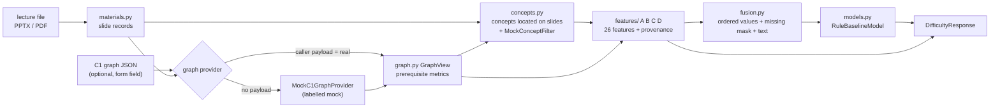

# C2 pre-lecture difficulty pipeline (Phase 1)

Design document for the difficulty half of component C2. Code: [`edusync/packages/c2`](../../edusync/packages/c2),
module `edusync_c2.difficulty`. Related: [architecture](architecture.md), [C1 -> C2 graph contract](c1-c2-graph-contract.md),
[package README](../../edusync/packages/c2/README.md).

> Status words used throughout: **real** = computed from real input; **mock** = placeholder that is labelled as such in
> every response; **TODO** = not built. Nothing here is a trained model and no accuracy is claimed.

## 1. Purpose and scope

C2 has two stages:

1. **Pre-lecture difficulty prediction** (this document, Phase 1): from the lecture file (PPTX or PDF, the same file
   C1 processed) and, optionally, C1's concept graph, predict a difficulty label (Low / Medium / High) per concept
   **before the lecture happens**.
2. **Live comprehension validation** (later, Phase 5): compare the predicted difficulty with poll/quiz evidence during
   the lecture. A rule-based placeholder exists (`comprehension.py`, `POST /api/c2/comprehension/evaluate`); it is not
   part of the Phase 1 work and has not been validated against real polls.

Phase 1 builds the **whole pipeline end to end**, with the hard parts mocked or marked TODO, so that each part can be
replaced one at a time without changing the response shape. What exists:

- a parser for PPTX and PDF lecture files;
- a way to accept C1's graph (as a request payload) or build a clearly labelled mock graph from slide titles;
- 26 registered features in four groups: 18 computed from the lecture file (3 of them PPTX only), 6 that need the C1 graph, 1 mocked placeholder and 1 TODO (see section 4; the vocabulary features of group A became real in Phase 2, milestone M1, see "Feature A method" in section 4);
- ordered, mask-aware fusion input;
- a transparent rule baseline (`RuleBaselineModel`) that produces a label and a raw score, with no probabilities and no
  confidence;
- an API route and a deterministic synthetic data generator for tests.

What does **not** exist: a trained model, a labelled dataset, a real C1 connection at runtime, persistence, any
evaluation of prediction quality, and the live stage.

## 2. Architecture



Flow in `difficulty/pipeline.py` (`DifficultyPipeline.run`):

1. `materials.parse_materials` turns the upload into `SlideRecord`s (title, text, notes, paragraphs with bullet level,
   picture/chart/table/shape counts, formula and code hints). PDF yields text per page only.
2. The graph comes from `PayloadGraphProvider` when the caller supplied `c1_graph` (a real input, not verified by C2),
   otherwise from `MockC1GraphProvider` (concepts = slide titles, prerequisites = slide order, labelled mock).
3. `concepts.build_concepts` takes concepts from the C1 nodes (fallback: the C1 `concepts` list), locates each one on
   the slides (whole-phrase, case-insensitive match of label or id in title or text) and passes them through the
   concept filter. `MockConceptFilter` keeps all of them.
4. `features.compute_all_features` produces all 26 features for each concept, each with a status and a source.
5. `fusion.build_fusion_input` orders the features by registry, marks unavailable (and, by default, mocked) ones as
   missing, and builds the concept text (concept label + description + slide text, max 1500 characters).
6. The model predicts a label per concept (`None` when too few features were computed).
7. The response carries the inputs, a status per stage, the model info, the predictions and the TODO list.

The pipeline is deterministic: the response contains no timings, clocks or random ids.

## 3. Module map

All paths are under `edusync/packages/c2/src/edusync_c2/`.

| File | Purpose |
|------|---------|
| `router.py` | HTTP routes: `/difficulty`, `/difficulty/info`, `/health`, `/comprehension/evaluate` |
| `comprehension.py` | Rule-based poll/quiz flagging (later stage, unchanged by Phase 1) |
| `schemas.py` | Request/response models of the comprehension route |
| `difficulty/schemas.py` | All Phase 1 contracts: C1 graph input, slide/concept/feature records, fusion, model output, `DifficultyResponse` |
| `difficulty/materials.py` | PPTX/PDF parser, upload validation (`MaterialsError`), formula and code detectors |
| `difficulty/graph.py` | `GraphView`: valid prerequisite edges and per-concept metrics |
| `difficulty/providers.py` | Graph providers: `PayloadGraphProvider`, `MockC1GraphProvider`, `C1ApiGraphProvider` (TODO, raises `NotImplementedError`) |
| `difficulty/concepts.py` | Concepts from graph nodes, slide alignment, `ConceptFilter`, `MockConceptFilter` |
| `difficulty/registry.py` | `FEATURE_SPECS` (the 26 features, in order), `PHASE1_TODO` |
| `difficulty/features/language.py` | Group A processor and `lexical_difficulty` |
| `difficulty/features/vocab.py` | `VocabularyAnalyzer`: word-piece fragmentation, unfamiliar share and domain-term share; shared default analyzer with one cached first load |
| `difficulty/features/wordpiece.py` | Pure-Python BERT WordPiece (uncased) over the vendored MiniLM vocabulary |
| `difficulty/features/lexicon.py` | Loader and plural fold of the curated CS/IT domain lexicon |
| `difficulty/resources/` | Vendored data: `bert_uncased_vocab.txt`, `domain_terms.txt`, `NOTICE`, `LICENSE-APACHE-2.0.txt`, `.gitattributes` (LF line endings) |
| `difficulty/features/prerequisites.py` | Group B processor |
| `difficulty/features/explanation.py` | Group C processor (definition/example/step regexes, diagram count) |
| `difficulty/features/density.py` | Group D processor |
| `difficulty/features/__init__.py` | `compute_all_features`: all 26 in registry order |
| `difficulty/fusion.py` | `build_fusion_input`, `to_vector`, `summarize_features` |
| `difficulty/models.py` | `DifficultyModel` protocol, `RuleBaselineModel`, `MiniLMFusionModel` (TODO) |
| `difficulty/pipeline.py` | `DifficultyPipeline`: orchestration, stage statuses, warnings |
| `difficulty/synthetic.py` | Seeded synthetic decks (PPTX/PDF), C1 graphs (v0/v1), rule labels |
| `scripts/make_synthetic_data.py` | CLI around `synthetic.py` (one level up, in `edusync/packages/c2/`) |

## 4. The 26 features

Source of truth: `difficulty/registry.py`. The column "Phase 1" is the registry's `phase1` field:
`real` computed from the lecture file; `real_needs_structure` computed for PPTX only (PDF: unavailable); `graph` needs
the C1 graph (from a mock graph the status is `mocked`); `mock` placeholder value; `todo` not built.

| # | Name | Group | Phase 1 | Description |
|---|------|-------|---------|-------------|
| 1 | `lang.avg_sentence_length` | A | real | Mean words per sentence on the slides. |
| 2 | `lang.avg_word_length` | A | real | Mean letters per word on the slides. |
| 3 | `lang.long_word_ratio` | A | real | Share of words with 9+ letters (technical proxy). |
| 4 | `lang.lexical_score` | A | real | Transparent lexical difficulty heuristic in [0, 1]. |
| 5 | `lang.concept_term_density` | A | real | Concept mentions per 100 words on its slides. |
| 6 | `lang.unfamiliar_vocab_ratio` | A | real | Share of words that need 2+ MiniLM word pieces (or are `[UNK]`). |
| 7 | `lang.subword_fragmentation` | A | real | Mean MiniLM word pieces per word. |
| 8 | `lang.domain_term_ratio` | A | real | Share of words in the curated CS/IT lexicon. |
| 9 | `prereq.direct_count` | B | graph | Number of direct prerequisites. |
| 10 | `prereq.chain_depth` | B | graph | Longest prerequisite chain below the concept. |
| 11 | `prereq.transitive_count` | B | graph | All distinct (transitive) prerequisites. |
| 12 | `prereq.mean_confidence` | B | graph | Mean confidence of direct prerequisites. |
| 13 | `prereq.curriculum_defined_share` | B | graph | Share of direct prerequisites from the curriculum. |
| 14 | `expl.definition_count` | C | real | Definition phrases on the concept's slides. |
| 15 | `expl.example_count` | C | real | Worked-example phrases on the concept's slides. |
| 16 | `expl.step_count` | C | real | Step-by-step markers (Step 1, numbered lists). |
| 17 | `expl.diagram_support` | C | real_needs_structure | Pictures + charts on its slides (PPTX). |
| 18 | `expl.semantic_support_score` | C | mock | TODO: semantic definition/example detection. |
| 19 | `dens.words_per_slide` | D | real | Mean words per concept slide. |
| 20 | `dens.concepts_per_slide` | D | real | Mean distinct C1 concepts per concept slide. |
| 21 | `dens.formula_presence` | D | real | Share of concept slides that look like formulas. |
| 22 | `dens.code_presence` | D | real | Share of concept slides that look like code. |
| 23 | `dens.max_bullet_depth` | D | real_needs_structure | Deepest bullet level on its slides (PPTX). |
| 24 | `dens.shape_count_mean` | D | real_needs_structure | Mean shapes per concept slide (PPTX). |
| 25 | `dens.concept_frequency` | D | graph | C1 node frequency of the concept. |
| 26 | `dens.visual_complexity` | D | todo | TODO: diagram/visual complexity analysis. |

Groups: A = technical vocabulary and language complexity, B = prerequisite and concept complexity, C = explanation and
example support, D = information density and structure.

Notes on the real features: they are regex and counting heuristics (the three vocabulary features count word pieces and lexicon hits, see below) over the text of the slides that mention the
concept (`definition`/`example`/`step` cues in `features/explanation.py`; formula and code hints in `materials.py`).
They are cheap proxies, not measurements of how a student experiences the slide.

### Feature A method (vocabulary, Phase 2 milestone M1)

Three group A features measure vocabulary. They replace the earlier 0.0 placeholder of `lang.unfamiliar_vocab_ratio`
and add two siblings (24 features became 26; group sizes are now A = 8, B = 5, C = 5, D = 8). The five other group A
features are untouched and keep their regex word rule (`[A-Za-z][A-Za-z'-]*`).

| Feature | Definition | Range |
|---------|------------|-------|
| `lang.unfamiliar_vocab_ratio` | share of words that need `MIN_PIECES_UNFAMILIAR = 2` or more word pieces, or are `[UNK]` | 0..1 |
| `lang.subword_fragmentation` | mean word pieces per word (`[UNK]` counts as 1 piece) | >= 1.0 |
| `lang.domain_term_ratio` | share of words in the curated CS/IT lexicon | 0..1 |

Order inside group A (registry order): the five old features, `lang.unfamiliar_vocab_ratio`, then
`lang.subword_fragmentation` and `lang.domain_term_ratio`. Adding two features changed the registry order and
`feature_schema_hash()`; no trained model artifact exists yet, so nothing recorded the old hash.

**Word rule (the three new features only).** Words are runs of Unicode letters (`[^\W\d_]+`), so hyphens, apostrophes,
digits and underscores split words ("real-time" is two words, "don't" is "don" and "t", which is ignored). Words with
fewer than 2 letters are ignored. Each word is lowercased before lookup; the tokenizer also strips accents.

**Tokenizer.** A pure-Python BERT WordPiece (uncased) in `features/wordpiece.py` over the MiniLM vocabulary, vendored as
`difficulty/resources/bert_uncased_vocab.txt` (30,522 entries; SHA-256
`07eced375cec144d27c900241f3e339478dec958f92fddbc551f295c992038a3`; source `sentence-transformers/all-MiniLM-L6-v2`, revision
`1110a243fdf4706b3f48f1d95db1a4f5529b4d41`; Apache License 2.0). `NOTICE` and `LICENSE-APACHE-2.0.txt` sit beside it, and
a nested `.gitattributes` keeps the file LF-only so the hash is stable on Windows checkouts. The file is an unmodified
copy; no model weights are included and no dependency was added. A word of more than 100 characters, or one the greedy
longest-match cannot segment, becomes `[UNK]`. Parity with the Hugging Face `tokenizers` library is checked on 53 inputs
(accents, CJK, emoji, code, URLs, acronyms, 99/100/101-character words): `tests/difficulty/golden/wordpiece_pieces.json`
is the committed result (written by `scripts/make_wordpiece_golden.py`, which needs `tokenizers`), so CI checks parity
without that library; a test marked `ml` compares against the library live.

**Lexicon.** `difficulty/resources/domain_terms.txt` holds 851 single-word lowercase terms and acronyms of computer
science, IT and machine learning, written for this project (not copied from a glossary; the header says so). A word
counts if it is in the list, or after stripping a trailing `es` or `s` (not `ss`) it is ("databases", "indexes").

**Statuses.**

| Case | Result |
|------|--------|
| Concept not found on any slide | all eight group A features `unavailable`, note "concept not found in materials" |
| Slides found, no words (regex rule of the old five features) | all eight `unavailable`, note "no words on the concept's slides" |
| Words exist, but none under the new word rule (for example only one-letter words) | the three vocabulary features `unavailable`, note "no words for vocabulary analysis" |
| Vocabulary resources missing or unreadable | the three vocabulary features `unavailable`, note "vocabulary resources unavailable"; one WARNING `vocab_unavailable` per process; never an exception |
| Otherwise | all three `computed`; `source` is `materials:wordpiece` (unfamiliar ratio, fragmentation) or `materials:lexicon` (domain ratio) |

The old mocked 0.0 is gone, so `lang.unfamiliar_vocab_ratio` is never `mocked` any more. The analyzer is built once per
process under a lock and shared by the pipeline's worker threads; a load failure is cached too (restart the process to
retry). `DifficultyPipeline(vocab=...)` and `compute_all_features(..., vocab=...)` accept an injected analyzer. Logging:
see the `vocab_loaded` and `vocab_unavailable` events below; no slide text or words are logged.

**Illustrative fixture values.** Hand-written paragraphs of 61 to 67 words in `tests/difficulty/test_vocab.py`
(`EASY`, `MEDIUM`, `HARD`). These are illustrative fixture values, not a validation:

| Text | `lang.subword_fragmentation` | `lang.unfamiliar_vocab_ratio` | `lang.domain_term_ratio` |
|------|------------------------------|-------------------------------|--------------------------|
| easy (everyday narrative) | 1.0 | 0.0 | 0.0 |
| medium (database basics) | 1.044776 | 0.044776 | 0.059701 |
| hard (machine learning and cryptography jargon) | 1.557377 | 0.344262 | 0.295082 |

**Limits, stated plainly.**

- The features measure general-English rarity (via the MiniLM vocabulary) plus listed jargon. They do not measure
  pedagogical difficulty or how a student experiences the slides.
- `MIN_PIECES_UNFAMILIAR = 2` and the lexicon are unvalidated choices; no labelled data was used to set them.
- Inflection adds noise: "minimizes" needs 2 pieces and counts as unfamiliar although it is an ordinary word.
- The tokenizer alone misses most jargon. In a feasibility check on technical words only about 21% had 3 or more
  pieces; many (encryption, gradient, authentication, kernel, database) are single tokens. That is why the lexicon is a
  separate feature and is not folded into the tokenizer feature.
- The lexicon is CS/IT/ML-oriented and will not fit every course; for other subjects `lang.domain_term_ratio` is
  mostly 0 and says little.
- The seeded synthetic decks are almost constant for these features (about 96% of their words are single tokens), so
  they must not be used to judge them. Use the fixtures above or real lecture text instead.
- The baseline model weights are unchanged and the baseline scores and labels of the synthetic decks are identical to
  before; `tests/difficulty/test_baseline_golden.py` proves it.

Tests: `test_wordpiece.py`, `test_lexicon.py`, `test_vocab.py`, `test_vocab_resources.py`, `test_features_language.py`
under `edusync/packages/c2/tests/difficulty/`.

## 5. Statuses and provenance

Every `FeatureValue` in the response has a `status`, a `source` and a `note`.

`FeatureStatus`:

| Status | Meaning | Rule in the code |
|--------|---------|------------------|
| `computed` | Real value from real inputs | Language, explanation and density features with slides found; group B from a caller-supplied graph; `dens.concept_frequency` from a caller graph |
| `mocked` | Placeholder, or computed from a mocked input; never treated as real | `expl.semantic_support_score` (0.0) always; every group B feature and `dens.concept_frequency` when the graph is the mock graph |
| `unavailable` | Cannot be produced; carries no value | No prerequisite edges in the graph -> all five group B features, note "C1 graph has no prerequisite edges"; concept id unknown to the graph -> group B; PDF -> `expl.diagram_support`, `dens.max_bullet_depth`, `dens.shape_count_mean`; concept not found on any slide -> every slide-based feature of groups A, C, D; vocabulary resources missing, or no words under the vocabulary word rule -> the three vocabulary features of group A (see "Feature A method"); no direct prerequisites -> `prereq.mean_confidence` and `prereq.curriculum_defined_share`; `dens.visual_complexity` always (TODO) |

A computed value never hides a mock: a feature derived from the mock graph is `mocked`, not `computed`.

`InputSource` (`inputs[]` in the response): `name` is `materials` or `c1_graph`, `kind` is `real`, `mock` or `none`.
The materials are always `real`; the graph is `real` when the caller supplied it and `mock` otherwise.

`StageStatus` (`stages[]`): `materials`, `graph`, `concepts`, `features`, `fusion`, `model`, each with
`ok` / `partial` / `mocked` / `skipped` / `failed` and a detail text. In Phase 1 the pipeline emits `ok`, `partial` and
`mocked` (the concept stage is `mocked` while `MockConceptFilter` is in use; the graph stage is `mocked` for a mock
graph).

A prediction itself has `status` `ok` (all 26 features computed), `partial` (some mocked or unavailable) or `failed`
(not enough computed features, `difficulty` is `null`). Because one feature is always mocked and one is always
unavailable, a Phase 1 prediction is expected to be `partial`.

## 6. Fusion and the baseline model

**Fusion** (`fusion.py`): the features are ordered as in the registry; each gets a `missing` flag. Unavailable features
are missing; mocked features are also treated as missing unless the pipeline is built with `use_mocked_features=True`
(off by default). `to_vector` yields values (0.0 for missing) and a mask (1 = missing) for a future learned model.
Text for a text encoder is the concept label, the C1 description (if any) and the text of the concept's slides.

**Baseline** (`models.py`, `RuleBaselineModel`, kind `baseline`, name `rule_baseline`, version `0.1`): a transparent
weighted rule with fixed, untuned constants chosen for readability. It is not trained, outputs **no probabilities and
no confidence** (`probabilities` and `confidence` are always `null`), and its `score` is a raw rule score in [0, 1], not
a probability.

Difficulty-raising components (feature: weight; normalised = `min(max((x - offset) / span, 0), 1)`):

| Feature | Weight | Offset | Span |
|---------|--------|--------|------|
| `lang.lexical_score` | 0.25 | 0 | 1 |
| `dens.words_per_slide` | 0.15 | 0 | 120 |
| `dens.concepts_per_slide` | 0.10 | 1 | 4 |
| `dens.formula_presence` | 0.10 | 0 | 1 |
| `dens.code_presence` | 0.05 | 0 | 1 |
| `prereq.direct_count` | 0.10 | 0 | 4 |
| `prereq.chain_depth` | 0.10 | 0 | 4 |

Steps:

1. Use only the components that are computed and not missing. If fewer than `MIN_COMPONENTS = 3` are available, the
   concept gets no prediction (`failed`).
2. `base` = weighted mean of the normalised components, dividing by the weights actually used.
3. Support credit = `SUPPORT_CREDIT_MAX (0.25) * sum(min(x, 1)) / 3` over those of `expl.definition_count`,
   `expl.example_count`, `expl.step_count` that are computed (the divisor is always 3, so a missing support feature
   gives less credit).
4. `score = clamp(base - credit, 0, 1)`; label Low if `score < LOW_MAX (0.12)`, Medium if `score < MEDIUM_MAX (0.25)`,
   otherwise High. The two thresholds are placeholders that are **not validated**: the code comments say they were placed where the baseline scores of the three synthetic decks separate, so labels spread across the classes; matching synthetic labels is circular.

The `explanation` list of a prediction states each normalised component, the credit and the final thresholds.
Group B components therefore only count when the graph is real: from a mock graph they are `mocked`, hence missing.

`MiniLMFusionModel` is a **TODO placeholder** (Phase 3, kind `todo`); `predict` raises `NotImplementedError`.

## 7. API

Routes (mounted by the API under `/api/c2`, see `router.py`):

| Route | Notes |
|-------|-------|
| `POST /api/c2/difficulty` | multipart form: `file` (required, `.pptx` or `.pdf`), `c1_graph` (optional text field holding C1's JSON exactly as C1 returns it) |
| `GET /api/c2/difficulty/info` | model info, graph provider name, concept filter name, the 26 `FeatureSpec`s and the TODO list |
| `GET /api/c2/health` | component health |
| `POST /api/c2/comprehension/evaluate` | unchanged; belongs to the later live stage (Phase 5 code) |

The old `{text}` JSON body of `/api/c2/difficulty` no longer works; the route now takes a file.

Errors: 400 unsupported file type, empty file, content that does not match the extension, corrupt file, encrypted PDF;
413 file larger than the limit (`min(EDUSYNC_MAX_UPLOAD_MB, 100)` MB at the route, 100 MB cap); 422 file without
extractable text, or a `c1_graph` that is not valid JSON or does not match C1's response shape.

```bash
# mock graph (labelled as mock in the response)
curl -F "file=@lecture.pptx" http://localhost:8100/api/c2/difficulty

# with C1's graph, as C1 returned it
curl -F "file=@lecture.pptx" -F "c1_graph=<graph.json" http://localhost:8100/api/c2/difficulty
```

Trimmed example response (real output of `DifficultyPipeline().run(...)` on a synthetic 4-concept deck with its v1
synthetic graph; reduced to 2 concepts and 6 features per concept, other parts replaced by `...`). The values come
from synthetic text and say nothing about real lectures.

```json
{
  "pipeline_version": "0.1.0-phase1",
  "lecture_id": "synthetic-lecture-1",
  "filename": "lecture_1.pptx",
  "file_type": "pptx",
  "slide_count": 6,
  "inputs": [
    {"name": "materials", "kind": "real", "detail": "lecture_1.pptx (pptx, 6 slides)"},
    {
      "name": "c1_graph",
      "kind": "real",
      "detail": "C1 graph supplied by the caller (v0 dummy or v1); not verified by C2"
    }
  ],
  "stages": [
    {"name": "materials", "status": "ok", "detail": "6 slides parsed"},
    {"name": "graph", "status": "ok", "detail": "C1 graph supplied by the caller ..."},
    {
      "name": "concepts",
      "status": "mocked",
      "detail": "4 concepts, 4 aligned, 0 not found in materials; concept filter is a mock (keeps all)"
    },
    {"name": "features", "status": "partial", "detail": "some features are mocked or unavailable"},
    {"name": "fusion", "status": "ok", "detail": "ordered features with missing masks"},
    {"name": "model", "status": "ok", "detail": "rule_baseline (baseline): rule-based baseline, not trained"}
  ],
  "model": {"name": "rule_baseline", "version": "0.1", "kind": "baseline", "trained_on": null, "...": "..."},
  "predictions": [
    {
      "concept_id": "linear-tensor",
      "label": "Linear Tensor",
      "difficulty": "Medium",
      "score": 0.1582,
      "probabilities": null,
      "confidence": null,
      "alignment_status": "aligned",
      "slide_indexes": [3],
      "features": [
        {"name": "lang.lexical_score", "group": "A_language", "value": 0.1396, "status": "computed",
         "source": "materials:regex", "note": ""},
        {"name": "prereq.direct_count", "group": "B_prerequisites", "value": 1.0, "status": "computed",
         "source": "c1_graph:prerequisite_edges", "note": ""},
        {"name": "prereq.mean_confidence", "group": "B_prerequisites", "value": 0.62, "status": "computed",
         "source": "c1_graph:prerequisite_edges", "note": ""},
        {"name": "expl.example_count", "group": "C_explanation", "value": 1.0, "status": "computed",
         "source": "materials:regex", "note": ""},
        {"name": "dens.words_per_slide", "group": "D_density", "value": 73.0, "status": "computed",
         "source": "materials:regex", "note": ""},
        {"name": "dens.visual_complexity", "group": "D_density", "value": null, "status": "unavailable",
         "source": "todo:visual_complexity", "note": "TODO: visual complexity analysis not implemented"}
      ],
      "feature_summary": "...",
      "status": "partial",
      "explanation": [
        "lang.lexical_score = 0.14 (computed, weight 0.25)",
        "dens.words_per_slide = 0.61 (computed, weight 0.15)",
        "...",
        "support credit = -0.17 (3 of 3 support features computed)",
        "score 0.16 -> Medium (Low < 0.12, Medium < 0.25, else High); baseline, not trained"
      ],
      "warnings": []
    },
    {"concept_id": "sparse-matrix", "label": "Sparse Matrix", "difficulty": "Low", "score": 0.0322, "...": "..."}
  ],
  "todo": ["..."],
  "warnings": [],
  "disclaimer": "Phase 1 baseline: rule-based labels from simple features, not a trained model. No probabilities or accuracy are claimed; mocked inputs and features are labelled."
}
```

## 8. Mock and TODO register

`PHASE1_TODO` in `difficulty/registry.py` (also returned in every response and by `/difficulty/info`):

1. Real C1 connection (`C1ApiGraphProvider`); the graph is a mock unless supplied by the caller.
2. Concept filter: alias merging (TDE = Transparent Data Encryption) and generic phrases.
3. Feature C: semantic definition/example detection.
4. Feature D: visual/diagram complexity analysis.
5. `MiniLMFusionModel` and learned feature fusion (Phase 3, trained on lecturer labels).
6. Calibrated confidence and probabilities (never invented before a trained, evaluated model).
7. Prediction persistence for Phase 5 comparison with live comprehension.

The former item "Feature A: unfamiliar-vocabulary score from a domain word list" was removed when Feature A became real (Phase 2, M1).

Per-module mocks and TODOs found in the code:

| Where | What |
|-------|------|
| `providers.MockC1GraphProvider` | Fabricates a graph from slide titles (titles ending in `?` or without alphanumerics are skipped): co-mention edges for titles sharing a slide, prerequisite edges between consecutive titles (confidence 0.5, `source_type` `inferred`); not real prerequisites |
| `providers.C1ApiGraphProvider` | Not implemented (`NotImplementedError`) |
| `providers.PayloadGraphProvider` | The caller's graph is trusted as C1's output; C2 does not verify that it matches the file |
| `concepts.MockConceptFilter` | Keeps every concept (name `mock_keep_all`) |
| `features/language.py`, `features/vocab.py` | No mock left in group A. Limits: the vocabulary features measure general-English rarity plus a CS/IT/ML lexicon, with unvalidated thresholds (see "Feature A method") |
| `features/explanation.py` | `expl.semantic_support_score` is a 0.0 placeholder (mocked); definition/example/step counts are regex cues only |
| `features/density.py` | `dens.visual_complexity` unavailable (TODO) |
| `models.MiniLMFusionModel` | Not implemented (Phase 3) |
| `models.RuleBaselineModel` | Weights and thresholds are untuned guesses |
| `pipeline.DifficultyPipeline` | `use_mocked_features` is off; mocked features never feed the baseline |
| API | Predictions are not stored; the C1 -> C2 runtime hand-off is not implemented |

## 9. How to run

From `edusync/` (see [development](development.md) for setup):

```bash
uv sync
uv run pytest packages/c2                 # C2 tests, including tests/difficulty
uv run python -m edusync_api              # API on 127.0.0.1:8100, docs at /docs
uv run ruff check . && uv run ruff format --check .
```

Synthetic data (all synthetic, no real course material):

```bash
uv run python packages/c2/scripts/make_synthetic_data.py                  # defaults: seed 42, 3 lectures, 8 concepts
uv run python packages/c2/scripts/make_synthetic_data.py --seed 7 --lectures 5 --concepts 10 --out some/dir
```

Options: `--seed` (default 42), `--lectures` (default 3), `--concepts` (default 8), `--out` (default
`edusync/packages/c2/data/synthetic/`). Lecture k is built with `make_deck_spec(seed + k, concepts, ...)`
for k = 1..lectures, with lecture id `synthetic-lecture-<k>`. Per lecture it writes `lecture_<k>.pptx`, `lecture_<k>.pdf`,
`lecture_<k>_graph_v0.json` and `lecture_<k>_graph_v1.json`; shared files are `labels.csv` and `README.txt`. The
`.pptx` and `.pdf` files are git-ignored (regenerate them); labels, graphs and README are kept in the repository. PPTX
files embed zip timestamps, so compare parsed content, not bytes.

**The labels are circular.** `labels.csv` comes from `synthetic_label` in `difficulty/synthetic.py`, a documented rule
over the same properties the generated decks expose (prerequisites, words, formula, code, bullet depth, definition,
examples, steps, picture). Any model score measured against these labels is circular and must never be reported as
accuracy; the data only exercises the pipeline end to end.

## 10. Design decisions

- **C2 never imports C1.** Packages stay independent. The C1 graph reaches C2 as a request payload (the `c1_graph` form
  field) in C1's own response shape, so the contract is a JSON contract ([c1-c2-graph-contract.md](c1-c2-graph-contract.md)).
- **Graph via payload, mock otherwise.** A caller-supplied graph is the only real graph input today. Without one, a mock
  keeps the pipeline runnable, and every value derived from it is marked `mocked`.
- **C2 owns a richer slide parser.** C1's extractor flattens text and loses titles, speaker notes, bullet levels and
  picture/chart/table counts, which the C and D feature groups need. This duplicates some parsing; accepted for Phase 1.
- **Ordinal labels.** Low < Medium < High is an ordered scale; later metrics must respect the order (section 12).
- **Mocked = missing for fusion.** A placeholder must not look like a measurement to a model, so mocked features are
  masked out by default.
- **No probabilities, no confidence in the baseline.** An untrained rule has no calibration; inventing a confidence
  would be misleading. The fields exist in the response and stay `null`.
- **`/api/c2/difficulty` was replaced.** The old text-only route is gone because the new features need slide structure
  and a graph.
- **Deterministic output.** Same input gives the same response; helps tests and later comparison.
- **Registry as single source of truth.** Feature names and order live in `registry.py`; every processor must return
  exactly its group, even when values are unavailable.

## Phase 1 Definition of Done - evidence

Paths are relative to `edusync/packages/c2/` unless they start with `docs/`. Tests live in `tests/difficulty/`.

| # | Item | Status | Evidence | Remaining gap |
|---|------|--------|----------|---------------|
| 1 | End-to-end pre-lecture difficulty pipeline implemented | Done | `src/edusync_c2/difficulty/pipeline.py`; `POST /api/c2/difficulty` in `router.py`; `test_pipeline.py` (`test_v1_payload`, `test_v0_payload_group_b_unavailable`, `test_mock_provider`, `test_deterministic_and_roundtrip`), `test_router.py` (`test_with_graph`, `test_without_graph`, `test_pdf`) | The model is a rule baseline, not trained |
| 2 | Four feature modules have defined inputs, outputs and test coverage | Done | `difficulty/features/{language,prerequisites,explanation,density}.py`; registry in `difficulty/registry.py`; `test_features_language.py`, `test_features_prerequisites.py`, `test_features_explanation.py`, `test_features_density.py`, `test_features_registry.py` (`test_names_and_order`, `test_statuses_real_deck`); group A vocabulary features: `test_vocab.py`, `test_wordpiece.py`, `test_lexicon.py`, `test_vocab_resources.py`, `test_baseline_golden.py` | Some features are mocked or unavailable by design (see the register in section 8) |
| 3 | C1 knowledge-graph integration has a documented interface and can be tested with sample data | Partially done / pending C1 | Interface and contract: `docs/edusync/c1-c2-graph-contract.md`; `difficulty/graph.py`, `providers.py`; validator `difficulty/contract_check.py` and `scripts/validate_c1_graph.py`; synthetic v0/v1 graphs from `scripts/make_synthetic_data.py`; tests `test_contract_check.py`, `test_validate_script.py`, `test_providers.py`, `test_graph.py`, `test_synthetic.py` | C1's real v1 sample file is not on GitHub, so the contract has never been checked against real C1 output. `C1ApiGraphProvider` is not implemented |
| 4 | Feature fusion and the MiniLM prediction interface are defined and connected | Partially done | Fusion: `difficulty/fusion.py`, `test_fusion.py`. Interface, factory and artifact spec: `difficulty/models.py` (`create_model`, `OnnxFusionModel.from_artifacts`, `MiniLMFusionModel`), `docs/edusync/c2-model-and-blueprint.md`; `test_model_contract.py` (reusable contract checks), `test_model_artifacts.py`, `test_models.py`; HTTP 501 selection in `test_router.py` (`test_minilm_is_501_and_not_cached`, `test_artifact_error_is_501`, `test_model_not_implemented_at_inference_is_501`) | Only the rule baseline can predict. `OnnxFusionModel` validates its artifacts but does not run inference, and `MiniLMFusionModel` is a TODO marker; both wait for Phase 3 |
| 5 | The existing MiniLM blueprint has been located and assessed for reuse | Done | Assessment and the copy-in-Phase-3 decision in `docs/edusync/c2-model-and-blueprint.md`, section 5 | The assessment is documentation only; no blueprint code has been copied or run |
| 6 | The pipeline returns structured concept-level results | Done | `DifficultyResponse` and `ConceptPrediction` in `difficulty/schemas.py` (label, raw `score`, feature statuses, provenance); `test_schemas.py`, `test_pipeline.py::test_deterministic_and_roundtrip`, `test_router.py::test_info_shows_model_fields` | `score` is a raw baseline value, not a probability; no probabilities exist yet |
| 7 | Mocked and unavailable functionality is explicitly identified | Done | Per-feature status (computed / mocked / unavailable) and `source` in every response; mock graph warning; `PHASE1_TODO` in the registry; `GET /difficulty/info`; section 8 of this document; `test_features_registry.py`, `test_fusion.py::test_use_mocked`, `test_pipeline.py::test_mock_provider` | The register must be kept current as features are replaced (see the checklist below) |
| 8 | Unit tests and an end-to-end test demonstrate the workflow | Done | Unit tests per module in `tests/difficulty/`; end-to-end with synthetic data: `test_pipeline.py`, `test_router.py`, `test_synthetic.py`, `test_make_synthetic_data.py`; logging and warnings: `test_pipeline_logging.py`, `test_cycle_warning.py`. Run `uv run pytest packages/c2` from `edusync/` | Tests use synthetic decks and graphs only; no real lecture or real C1 output |
| 9 | The code is ready for later phases to replace placeholders without redesign | Done | Model protocol and factory selected by `EDUSYNC_C2_MODEL`; registry-ordered features plus mask and `feature_schema_hash()` guard model artifacts; graph provider protocol; the model contract tests can be pointed at any new model | Not proven until a real model and a real C1 graph are plugged in (Phase 2 and 3) |

What remains before Phase 1 can be called fully closed: merge PR #19 and these closure commits, and obtain C1's real v1 sample graph to run the validator against it (item 3). Nothing else.

## Phase 5 hand-off: difficulty labels versus the 0-1 input

- Phase 1 returns an ordinal label per concept (Low, Medium, High) and a raw baseline `score` (0 to 1, `None` when too few inputs). The `score` is a rule-baseline value and is not a probability.
- The Phase 5 comprehension code takes `predicted_difficulty` as a float in [0, 1] (`comprehension.py`, `schemas.py`, `POST /api/c2/comprehension/evaluate`). It raises the clarification threshold: `effective = min(1, threshold + 0.1 * predicted_difficulty)`, with the input clamped to [0, 1] (`DIFFICULTY_BOOST = 0.1`). A ratio of correct answers below `effective` gives a REVIEW flag, below `effective / 2` an URGENT flag.
- No mapping from label to float is defined, and none is invented now. The two components are not connected: the live stage does not read the pre-lecture output.
- Open decision for Phase 5: how to turn the pre-lecture output into that float. Options to evaluate, none chosen:
  1. Per-label constants (one value each for Low, Medium, High), chosen on real data rather than guessed.
  2. An expected value computed from calibrated class probabilities, once a trained model that outputs them exists (Phase 3).
  3. The raw baseline `score` used directly, which would need evidence that it is monotone with real difficulty, since it is not calibrated.
  4. Changing the live stage to accept the ordinal label instead of a float.
- Whatever is chosen should be evaluated against poll and quiz evidence, keeping in mind that a low poll score has causes other than difficulty.

## Logging and development conventions

**Using the logger.** Modules use `from edusync_c2.logger import get_logger` and `logger = get_logger(__name__)`. Names are placed under the `edusync_c2` namespace.

**Configuration.** `EDUSYNC_C2_LOG_LEVEL` (DEBUG, INFO, WARNING or ERROR; default INFO; see `settings.py`). Logging is configured once, when `get_pipeline()` builds the cached pipeline, and never at import. `configure_logging` sets the level of the `edusync_c2` logger; it adds its own stderr handler only if the root logger has no handlers, so it does not touch an existing root logging setup.

**Line format.** Handler format: `%(asctime)s %(levelname)s %(name)s [%(request_id)s] %(message)s`. The message is the event name first, then `key=value` fields.

| Event | Level | Fields |
|-------|-------|--------|
| `materials` | INFO | `type`, `bytes`, `slides`, `warnings` |
| `graph` | INFO | `source`, `nodes`, `edges`, `prerequisite_edges`, `ignored` |
| `concepts` | INFO | `total`, `aligned`, `not_found`, `filter`, `dropped` |
| `features` | INFO | `concepts`, `computed`, `mocked`, `unavailable` |
| `fusion` | INFO | `inputs`, `features_per_input` |
| `model` | INFO | `name`, `kind`, `predicted`, `none` |
| `done` | INFO | `concepts`, `duration_ms` |
| `vocab_loaded` | INFO | `words` (vocabulary entries), `lexicon` (terms), `sha` (first 8 hex digits of the vocabulary SHA-256); logged once per process, lazily on the first analysis (so during the first request's `features` step, before its `features` line), by `edusync_c2.difficulty.features.vocab` |
| `vocab_unavailable` | WARNING | `reason` (exception class name); logged once per process when the vocabulary resources cannot be loaded |
| `materials_rejected` | WARNING | `status`, `reason` |
| `graph_warning` | WARNING | `count` |
| `graph_cycle` | WARNING | `concepts` |
| `rejected` (router) | WARNING | `status`, `reason` (and `limit_mb` for 413) |
| `graph_warning_detail`, `concepts_detail` | DEBUG | warning text; concept ids |

**Request id.** The router sets a short request id (`set_request_id(new_request_id())`) for each `POST /difficulty` call and resets it afterwards, so all lines of one request share the id in the `[...]` field (`-` outside a request). The id is used in logs only and is not returned in the response.

**Privacy.** Never log slide text, speaker notes or file names (the file type is enough). The vocabulary events carry sizes and a hash prefix only, never slide words. Concept ids appear only at DEBUG. Test: `test_pipeline_logging.py::test_privacy_nothing_sensitive_logged`.

**Timings only in logs.** `duration_ms` is logged on the `done` line and never put in the response, so responses stay deterministic (`test_response_independent_of_log_level`).

**Seeing logs.** Under uvicorn the lines go to stderr in the terminal, for example `EDUSYNC_C2_LOG_LEVEL=DEBUG uv run python -m edusync_api`. Under Docker use `docker compose logs edusync` (add `-f` to follow). If the host application configures root logging, C2 lines use that setup.

### Checklist for any new feature or step

- [ ] Add a registry entry in `difficulty/registry.py` (name, group, maturity). Names are `group.feature_name`; the registry order is the order of the fusion vector.
- [ ] Use the status rules: `computed` (real value), `mocked` (placeholder value, labelled) or `unavailable` (no value, with a reason note).
- [ ] Set the provenance `source` for the feature.
- [ ] Write unit tests, including the unavailable path.
- [ ] Add a metamorphic or golden test.
- [ ] Log through `get_logger` with `key=value` fields and follow the privacy rule above.
- [ ] Update the docs: the feature table (section 4) and the Mock and TODO register (section 8).
- [ ] Add no new mock without a registry entry and a note.
- [ ] Keep `edusync_c2` at 100% line and branch coverage, and ruff clean.
- [ ] Keep consistency: ordinal label order Low < Medium < High, and deterministic output for the same input.

## 11. Roadmap

**Phase 2 - real features, one at a time.** Each replaces a mock or TODO without changing the response shape:

1. Feature A: done in milestone M1. `lang.unfamiliar_vocab_ratio` is now real (MiniLM word pieces), with `lang.subword_fragmentation` and `lang.domain_term_ratio` added (section 4, "Feature A method"). Open: validate the thresholds and the lexicon against real lectures.
2. Feature D: `dens.visual_complexity`.
3. Feature C: `expl.semantic_support_score` (semantic definition/example detection).
4. Feature B against the real C1 graph (needs the v1 contract to exist; see the contract doc and its contract tests).
5. A real concept filter (alias merging, generic phrases), once C1 offers stable ids and aliases.
6. `C1ApiGraphProvider`, calling C1's graph endpoint with the same file.

**Phase 3 - dataset and model.**

- Labelling rubric that states **"difficult for which student level"** explicitly (the label is meaningless without it).
- Two raters per lecture and agreement measured before training.
- Lecturer labels are private data and are never committed (datasets are never committed; see architecture).
- Copy the blueprint `edusync/packages/blueprint_model` into a new `packages/c2_difficulty_model` and add a
  feature-fusion head (text embedding + the registry-ordered features and mask).
- Split by lecture (group split), never by concept, so a lecture is not in both train and test.
- Ordinal-aware metrics.

**Phase 4 - evaluation and explainability.**

- Metrics: macro-F1, balanced accuracy, quadratic weighted kappa, per-class errors.
- Ablations of the four feature groups (A, B, C, D).
- Baselines to beat: majority class, a lexical baseline, features-only, text-only. (The Phase 1 rule baseline is a
  further reference.)
- Explanations per prediction based on the real model, not on the rule text.

**Phase 5 - live comprehension validation.** Compare predicted difficulty with poll/quiz evidence per concept using C1's
current concept and C4 evidence. Coverage is not understanding: a concept that was covered is not a concept that was
understood, and a low poll score has other possible causes than difficulty. Existing code: `comprehension.py` (rule
based, not validated).

**Phase 6 - integration.** Persist predictions, wire the C1 -> C2 runtime hand-off, and show results in the BBB plugin.

## 12. Unverified

- The C1 v1 graph fields (`description`, prerequisite edges with direction, confidence, source_type) and the sample file
  `edusync/packages/c1/data/samples/sample_lecture_graph.json` were described by the C1 developer but are not on
  GitHub yet. C2 handles v1 only against its own synthetic graphs.
- Group B behaviour against real C1 output has not been run.
- No claim is made about how well the baseline matches real lecturer judgements; no real labelled data exists.
- The regex cues (definition, example, step, formula, code) have been tested on synthetic and unit-test text only.
- The Windows/Docker route to the API is documented elsewhere as unverified; the commands above were not checked
  against a running BBB.
- Upload limits at the route use `EDUSYNC_MAX_UPLOAD_MB` (default 200 in core settings) capped at 100 MB.
